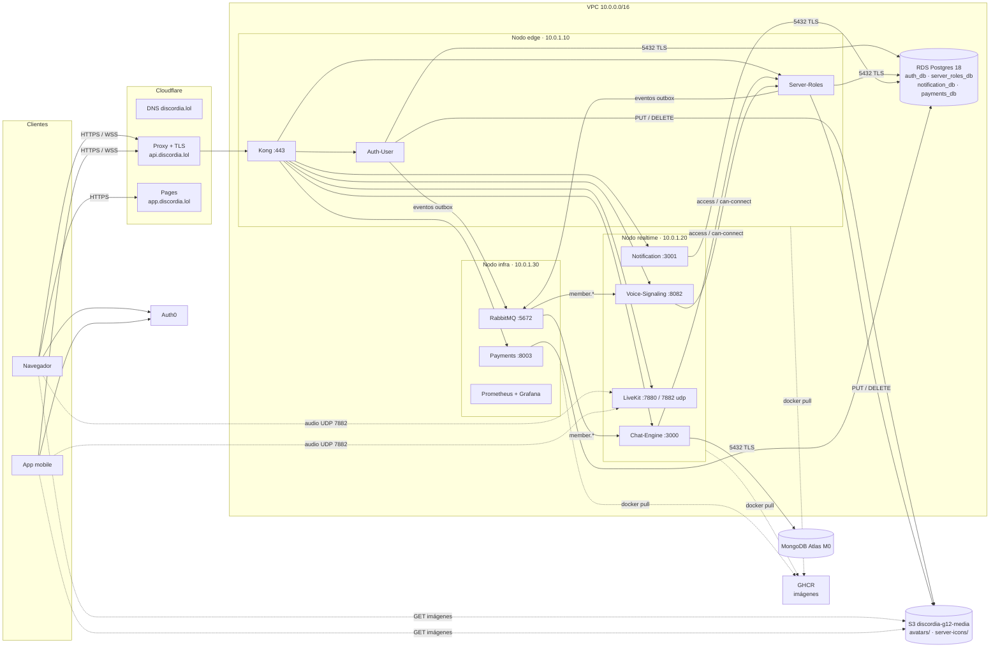
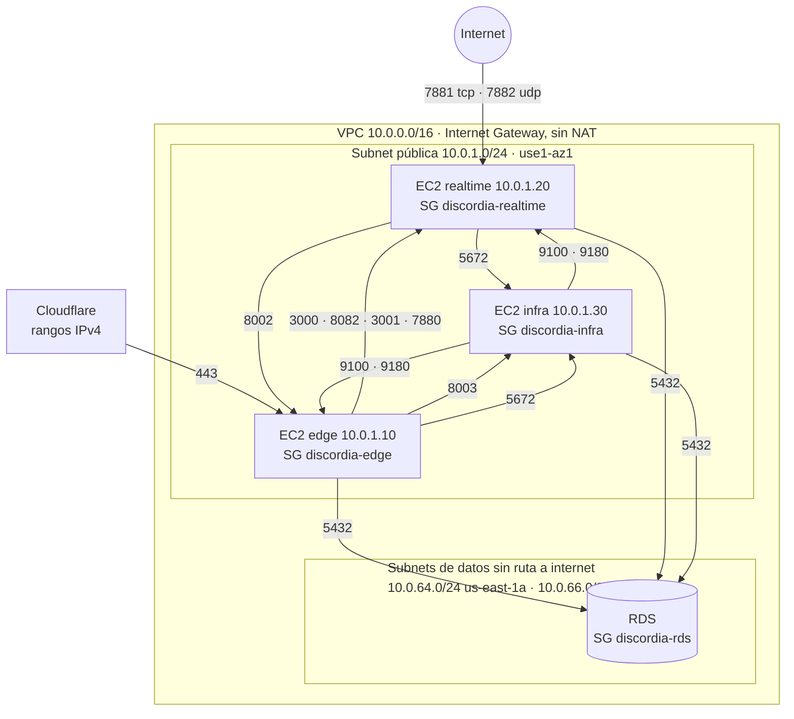
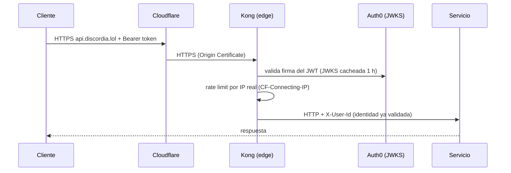
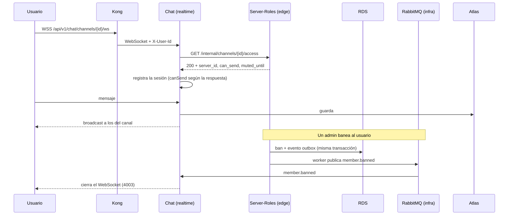
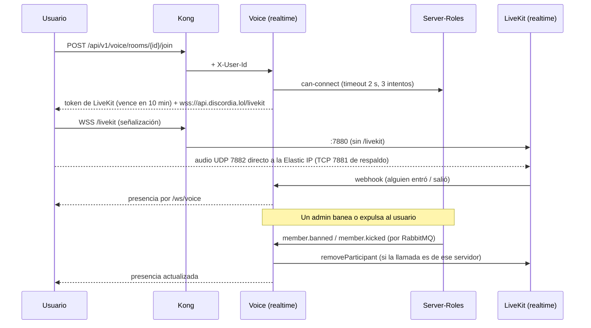
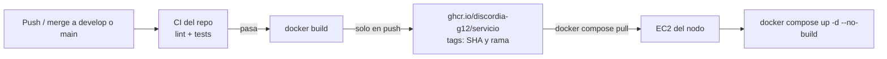

# Arquitectura y despliegue de Discordia

> Estado al 16/10/2026. Describe la arquitectura de tres nodos que reemplaza al monolito (una sola EC2 con
> `docker-compose.yml`), cómo se comunican los servicios, cómo se despliega y qué falta para el corte.
> Cambio del 16/10: **una sola VPC** (antes una por nodo con peering) y **todas las bases en el RDS** (antes
> un Postgres en contenedor por nodo).

## Índice

1. [Resumen](#1-resumen)
2. [Vista general](#2-vista-general)
3. [Nodos y servicios](#3-nodos-y-servicios)
4. [Red y seguridad](#4-red-y-seguridad)
5. [Cómo se comunican los servicios](#5-cómo-se-comunican-los-servicios)
6. [Datos](#6-datos)
7. [Gateway (Kong)](#7-gateway-kong)
8. [Frontend y mobile](#8-frontend-y-mobile)
9. [Resiliencia: qué pasa si se cae un nodo](#9-resiliencia-qué-pasa-si-se-cae-un-nodo)
10. [Observabilidad](#10-observabilidad)
11. [Despliegue](#11-despliegue)
12. [Costos](#12-costos)
13. [Decisiones y alternativas descartadas](#13-decisiones-y-alternativas-descartadas)

---

## 1. Resumen

| Tema | Decisión |
|---|---|
| Cómputo | 3 EC2 (`t3.micro`), una por nodo: **edge**, **realtime**, **infra** |
| Red | **Una VPC** (`10.0.0.0/16`), una cuenta de AWS. Un **Security Group por nodo** + uno para el RDS. IPs privadas fijas |
| Entrada de la API | `api.discordia.lol` → **Cloudflare** (proxy, TLS) → **Kong** en edge (443, solo IPs de Cloudflare) |
| Frontend | SPA en **Cloudflare Pages** (`app.discordia.lol`) |
| Bases relacionales | **Un RDS** (`discordia-db-cluster`, Postgres 18, `db.t4g.micro`) con una base por servicio. Ningún nodo corre Postgres |
| Historial del chat | **MongoDB Atlas M0** |
| Mensajería | **RabbitMQ** en infra; eventos publicados con el patrón **Outbox** |
| Audio de voz | **LiveKit** en realtime; el audio va directo por UDP 7882 (no pasa por Cloudflare) |
| Avatares e íconos de servidor | **Bucket S3** `discordia-g12-media`: Auth y Server-Roles suben, los clientes leen directo del bucket ([ADR-003](../Auth-User-Service/docs/ADR-003-Avatares.md)) |
| Imágenes de contenedores | Cada repo las publica en **GHCR** desde su CI (tag = SHA del commit) |
| Ejecución | **Un solo `deploy/docker-compose.yml`** con un *profile* por nodo; cada EC2 levanta el suyo |
| Infraestructura | **Terraform** (`infra/terraform/`): VPC, subnets, Security Groups, EC2, bucket S3 y sus usuarios IAM, DNS y Pages. El RDS solo se **lee** (no lo administra) |
| Observabilidad | Prometheus + Grafana en infra; Node Exporter + cAdvisor en los tres nodos |

---

## 2. Vista general



---

## 3. Nodos y servicios

Cada nodo es una EC2 en la subnet pública de la VPC, con IP privada fija y su propio Security Group. 

### Edge — `10.0.1.10` (Elastic IP, origen de Cloudflare)

| Servicio | Imagen | Puerto publicado | Memoria |
|---|---|---|---|
| `gateway` (Kong 3.4) | `ghcr.io/discordia-g12/gateway` | 443 → 8443 (TLS), 127.0.0.1:8000 | 256 MB |
| `gateway-redis` | `redis:7-alpine` | — | 64 MB |
| `auth-service` | `ghcr.io/discordia-g12/auth-service` | — | 256 MB |
| `auth-outbox-worker` | misma imagen que Auth | — | 128 MB |
| `server-roles-service` | `ghcr.io/discordia-g12/server-roles-service` | 8002 → 8080 (temporal, solo realtime) | 256 MB |
| `server-roles-outbox-worker` | misma imagen que Server-Roles | — | 128 MB |

### Realtime — `10.0.1.20` (Elastic IP: `NODE_IP` de LiveKit y allowlist de Atlas)

| Servicio | Imagen | Puerto publicado | Memoria |
|---|---|---|---|
| `chat-engine-service` | `ghcr.io/discordia-g12/chat-engine-service` | 3000 | 256 MB |
| `chat-redis` | `redis:7-alpine` | — | 160 MB |
| `voice-signaling-service` | `ghcr.io/discordia-g12/voice-signaling-service` | 8082 → 8080 | 256 MB |
| `livekit` | `livekit/livekit-server:v1.13.7` | 7880, 7881/tcp, 7882/udp | 384 MB |
| `voice-redis` | `redis:7-alpine` | — | 64 MB |
| `notification-service` | `ghcr.io/discordia-g12/notification-service` | 3001 → 3000 | 128 MB |
| `chat-mongo` | `mongo:7.0` | — | 512 MB — **solo local** (profile `local`) |

### Infra — `10.0.1.30` (IP pública automática, solo para salir a internet)

| Servicio | Imagen | Puerto publicado | Memoria |
|---|---|---|---|
| `rabbitmq` | `rabbitmq:3-management-alpine` | 5672, 127.0.0.1:15672 (panel) | 320 MB |
| `payments-service` | `ghcr.io/discordia-g12/payments-service` | 8003 → 8000 | 192 MB |
| `prometheus` | `prom/prometheus:v2.53.0` | 127.0.0.1:9090 | 256 MB |
| `grafana` | `grafana/grafana-oss:11.6.0` | 127.0.0.1:3030 | 128 MB |

### RDS (fuera de los nodos, en la misma VPC)

| Dato | Valor |
|---|---|
| Identificador | `discordia-db-cluster` (ya existía; es el del monolito) |
| Motor / clase | Postgres 18 / `db.t4g.micro`, una sola zona (sin Multi-AZ) |
| Usuario | `discordia_admin` (el maestro), el mismo para las cuatro bases |
| Red | DB subnet group `discordia-data` (subnets privadas en `us-east-1a` / `use1-az1` y `us-east-1f`, donde vive el RDS), Security Group `discordia-rds`, sin IP pública |
| TLS | Obligatorio (`rds.force_ssl = 1`, default de Postgres 18) |

### S3 (fuera de la VPC)

| Dato | Valor |
|---|---|
| Bucket | `discordia-g12-media` (`us-east-1`), creado por Terraform (`infra/terraform/storage.tf`) |
| Contenido | `avatars/` (lo escribe Auth) y `server-icons/` (lo escribe Server-Roles). Cada archivo es un WebP de 256×256 con nombre único (`<prefijo>/<uuid>.webp`, `Cache-Control: immutable`) |
| Lectura | Pública solo en esos dos prefijos (bucket policy); el resto del bucket es privado y las ACLs están desactivadas |
| Escritura | Un usuario IAM por servicio (`discordia-auth-media`, `discordia-server-roles-media`) que solo puede hacer `PutObject` / `DeleteObject` en su prefijo. No se usa el rol de la EC2: el servicio funciona igual en cualquier nodo |
| Claves | Las access keys no las crea Terraform (quedarían en el estado): se crean con `terraform output media_access_key_commands` y van al `nodes.env` de edge (`AUTH_AWS_*`, `SERVER_ROLES_AWS_*`) |
| Configuración de los servicios | `S3_BUCKET`, `S3_PUBLIC_BASE_URL` (`terraform output media_bucket`), `AWS_REGION`, `AWS_ACCESS_KEY_ID`, `AWS_SECRET_ACCESS_KEY`. Sin bucket o sin claves, la subida responde 503 y el resto del servicio funciona igual |

El binario pasa por el servicio (lo valida y lo normaliza con Pillow) pero no se guarda en él: la base
guarda solo la URL pública (`user_profiles.avatar_url`, `servers.icon_url`). Los clientes cargan las
imágenes directo desde la URL del bucket, sin pasar por Kong.

### Solo en local (profile `local`)

| Servicio | Para qué |
|---|---|
| `chat-mongo` | Hace de Atlas |
| `local-postgres` (`postgres:18-alpine`) | Hace de RDS: se publica en el 5432 del host y crea las cuatro bases con `init-dbs.sql` |

### En los tres nodos

| Servicio | Puerto | Memoria |
|---|---|---|
| `node-exporter` (métricas de la máquina) | 9100 (solo infra) | 32 MB |
| `cadvisor` (métricas de cada contenedor) | 9180 (solo infra) | 96 MB |

### Fuera de AWS

| Servicio | Plan | Para qué |
|---|---|---|
| Cloudflare | Free | DNS, proxy y TLS de la API, Pages (SPA) |
| Amazon S3 | (misma cuenta de AWS, fuera de la VPC) | Avatares e íconos de servidor |
| MongoDB Atlas | M0 | Historial del chat |
| Auth0 | (existente) | Identidad: login, tokens |
| GitHub / GHCR | Free | Código, CI, imágenes |

---

## 4. Red y seguridad



- **Una VPC** con una subnet pública (`10.0.1.0/24`) para las tres EC2 y dos subnets de datos
  (`10.0.64.0/24` en `us-east-1a`, `10.0.66.0/24` en `us-east-1f`) para el RDS. Las de datos no tienen ruta
  a internet; son dos porque AWS exige que un DB subnet group cubra al menos dos zonas. La de `us-east-1f`
  existe porque el RDS ya vivía en esa zona y al cambiarlo de VPC AWS no lo cambia de zona.
- **Sin NAT Gateway** (por un tema de costos mayormente): cada EC2 sale a internet con su IP pública y el Security Group
  bloquea la entrada.
- **El aislamiento lo dan los Security Groups, no la red**: cada nodo tiene el suyo y las reglas entre
  nodos apuntan al **grupo de origen** ("el RDS acepta 5432 del grupo de edge"), no a rangos de IP. Separar
  en VPCs no agregaba seguridad: con peering, lo que pasa o no pasa lo deciden igual los Security Groups.
- Las tres EC2 están en la misma zona (`us-east-1a` / `use1-az1`).
- **Sin SSH ni puerto 22**: se entra por **SSM Session Manager**.
- **IMDSv2 obligatorio**, disco cifrado, créditos de CPU en `standard` (si se agotan, la máquina se frena en
  vez de cobrar el excedente).

### Puertos abiertos (Security Groups)

Todo lo que no está en esta tabla está cerrado. El Admin API de Kong (8001), el panel de RabbitMQ,
Prometheus y Grafana **no se publican** (quedan en `127.0.0.1` del host; se accede con port forwarding de SSM).

| Security Group | Puerto | Desde | Para qué |
|---|---|---|---|
| `discordia-edge` | 443/tcp | Rangos de Cloudflare | Kong (API y WebSockets) |
| `discordia-edge` | 8002/tcp | grupo realtime | `access` / `can-connect` de Server-Roles (**temporal**) |
| `discordia-realtime` | 3000, 8082, 3001/tcp | grupo edge | Kong → Chat, Voice, Notification |
| `discordia-realtime` | 7880/tcp | grupo edge | Kong → señalización de LiveKit (`/livekit`) |
| `discordia-realtime` | 7881/tcp, 7882/udp | 0.0.0.0/0 | Audio WebRTC (LiveKit valida su propio token) |
| `discordia-infra` | 5672/tcp | grupos edge y realtime | RabbitMQ (workers de outbox y consumidores) |
| `discordia-infra` | 8003/tcp | grupo edge | Kong → Payments |
| `discordia-edge`, `discordia-realtime` | 9100, 9180/tcp | grupo infra | Prometheus → Node Exporter y cAdvisor |
| `discordia-rds` | 5432/tcp | grupos edge, realtime e infra | Auth, Server-Roles, Notification, Payments → RDS |

### Cloudflare

| Registro | Tipo | Destino | Proxy |
|---|---|---|---|
| `api` | A | Elastic IP de edge | **Proxied** (nube naranja) |
| `app` | CNAME | `discordia-webapp.pages.dev` | Proxied |

- TLS público lo da Cloudflare; entre Cloudflare y Kong, **Origin Certificate** (modo **Full (strict)**).
- Kong solo acepta a Cloudflare (Security Group) y toma la IP real del usuario del header
  `CF-Connecting-IP` (`KONG_TRUSTED_IPS`), así el rate limiting es por usuario y no por IP de Cloudflare.
- Cloudflare corta los WebSockets inactivos (~100 s): por eso el **heartbeat** (sección 9).

---

## 5. Cómo se comunican los servicios

### Reglas generales

- **Dentro de un nodo**: por nombre de contenedor, en la red de Docker del nodo (`edge`, `realtime`,
  `infra`). Un contenedor **no ve** los de otro nodo.
- **Entre nodos**: a la **IP del host + puerto publicado**, como entre máquinas distintas. Las direcciones
  son variables: `EDGE_HOST`, `REALTIME_HOST`, `INFRA_HOST` (en local `host.docker.internal`; en
  producción las IPs privadas).
- **Desde los clientes**: todo entra por Kong (`api.discordia.lol`), salvo el audio (directo a LiveKit).

### Mapa de llamadas

| Origen | Destino | Tipo | Dirección |
|---|---|---|---|
| Kong | Auth, Server-Roles | HTTP | mismo nodo (`auth-service:8000`, `server-roles-service:8080`) |
| Kong | Chat (REST y WS), Voice (REST y `/ws/voice`), Notification, LiveKit | HTTP / WebSocket | `REALTIME_HOST:3000/8082/3001/7880` |
| Kong | Payments | HTTP | `INFRA_HOST:8003` |
| Chat | Server-Roles `/internal/channels/{id}/access` | HTTP síncrono | `EDGE_HOST:8002` — al abrir cada WebSocket y al pedir el historial |
| Voice | Server-Roles `/internal/channels/{id}/can-connect` | HTTP síncrono (timeout + 3 reintentos) | `EDGE_HOST:8002` — al unirse a voz |
| Auth / Server-Roles (workers) | RabbitMQ | AMQP (publica) | `INFRA_HOST:5672` |
| Chat | RabbitMQ | AMQP (consume `member.*`) | `INFRA_HOST:5672` |
| Voice | RabbitMQ | AMQP (consume `member.banned`, `member.kicked`, `member.left`) | `INFRA_HOST:5672` |
| Voice | LiveKit | API de servidor | mismo nodo (`livekit:7880`) |
| LiveKit | Voice `/webhooks/livekit` | Webhook HTTP | mismo nodo |
| Prometheus | Exportadores de los 3 nodos | HTTP (scrape) | `<NODO>_HOST:9100/9180` |
| Auth, Server-Roles, Notification, Payments | RDS | Postgres con TLS | `DB_HOST:5432` (endpoint del RDS, por la VPC) |
| Chat | MongoDB Atlas | TLS | internet (allowlist: Elastic IP de realtime) |
| Auth | Auth0 | HTTPS | internet |
| Auth, Server-Roles | S3 (`PutObject` / `DeleteObject` en su prefijo) | HTTPS con su usuario IAM | internet (sin NAT ni VPC endpoint: sale por la IP pública de edge) |
| Clientes | S3 (avatares e íconos) | HTTPS (`GET` público) | internet, directo al bucket (no pasa por Kong ni por Cloudflare) |

### Pedido a la API



Los servicios confían en el header `X-User-Id` que agrega Kong: **por eso nadie fuera de Kong puede llegar a
sus puertos** (Security Groups).

### Eventos (Outbox + RabbitMQ)

Los servicios que cambian datos guardan el evento en una tabla `outbox_events` **en la misma transacción**
que el cambio. Un worker aparte lo publica en RabbitMQ (al menos una vez; los consumidores deduplican por
`message_id`). Si RabbitMQ está caído, los eventos esperan en la base.

| Productor | Exchange (topic) | Eventos |
|---|---|---|
| Auth-User | `user.events` | `user.registered`, `user.profile.updated` |
| Server-Roles | `server.events` | `channel.created/updated/deleted`, `channels.reordered`, `category.created/updated/deleted`, `categories.reordered`, `role.permissions_updated`, `role.deleted`, `member.role_assigned/removed`, `member.left`, `member.kicked`, `member.banned/unbanned`, `member.muted/unmuted` |

| Consumidor | Cola | Binding | Qué hace |
|---|---|---|---|
| Chat-Engine | `chat_engine_events` (durable) | `member.*` | ban / kick / salida → cierra el WebSocket; mute / unmute → habilita o bloquea el envío |
| Voice-Signaling | `voice_signaling_events` (durable) | `member.banned`, `member.kicked`, `member.left` | Saca al usuario de la llamada de ese servidor y lo bloquea para que no vuelva a entrar con un token viejo |

**Ver y escribir son permisos distintos** en el chat: `/internal/channels/{id}/access` responde 403 si el
usuario no es miembro, está baneado o no tiene `VIEW_CHANNELS`. Si puede ver, devuelve `can_send`
(`SEND_MESSAGES` y sin mute vigente) y `muted_until`. Un usuario muteado abre el canal y lee el historial,
pero no puede escribir; al abrir el WebSocket recibe `{ "type": "PERMISSIONS_UPDATED", "canSend": false }`
y, si el mute tiene vencimiento, el chat lo habilita solo cuando vence.

### Mensaje de chat y ban en vivo



### Voz



Voice guarda en Redis de qué servidor es cada llamada (`user:{id}:voice_server`, `channel:{id}:server`).
Al recibir un ban, una expulsión o una salida, saca al usuario de la sala solo si la llamada es de ese
servidor, y guarda un bloqueo (`voice:blocked:{servidor}:{usuario}`, 24 h). Si el usuario entra a una sala
de ese servidor con un token emitido antes, el webhook `participant_joined` lo saca. El bloqueo se borra
cuando vuelve a pasar por `/join` (que chequea `can-connect`).

---

## 6. Datos

| Dato | Dónde | Detalle |
|---|---|---|
| `auth_db` | RDS | La usa Auth-User (edge) |
| `server_roles_db` | RDS | La usa Server-Roles (edge) |
| `notification_db` | RDS | La usa Notification (realtime) |
| `payments_db` | RDS | La usa Payments (infra) |
| Historial del chat | MongoDB Atlas M0 | En local, `chat-mongo` (profile `local`) |
| Avatares | S3 `discordia-g12-media/avatars/` | Los sube Auth; la URL queda en `auth_db` (`user_profiles.avatar_url`) |
| Íconos de servidor | S3 `discordia-g12-media/server-icons/` | Los sube Server-Roles; la URL queda en `server_roles_db` (`servers.icon_url`) |
| Sesiones de voz, presencia | `voice-redis` (realtime) | Local al nodo |
| Pub/sub del chat | `chat-redis` (realtime) | `noeviction` |
| Rate limiting | `gateway-redis` (edge) | `allkeys-lru` |
| Eventos | RabbitMQ (infra) | Volumen persistente `rabbitmq-data` |

- **Una base por servicio, en una sola instancia**: ningún servicio lee la base de otro (se hablan por
  eventos).
- **Un solo usuario** (`discordia_admin`) para las cuatro. 
- **TLS**: Postgres 18 en RDS lo exige. Los servicios Python (asyncpg, psycopg2) lo negocian solos; el de
  Node (Notification) necesita `sslmode=no-verify` en la URL (`NOTIFICATION_DB_SSLMODE`): cifra pero no valida
  el certificado, porque Node no trae la CA de Amazon. CHEQUEAR SI hay que: montar el bundle de la CA de RDS y
  usar `verify-full`.
- **Backups**: los automáticos del RDS (snapshots diarios y restauración a un punto en el tiempo).
- En local, `local-postgres` (profile `local`) hace de RDS con las mismas bases (`init-dbs.sql`).

**Importante:** RabbitMQ y Grafana toman usuario y contraseña **solo la primera vez que arrancan** (con el
volumen vacío). Si después se cambia el valor en `nodes.env`, hay que cambiarlo también adentro
(`rabbitmqctl change_password`, etc.). Ver sección 15.

---

## 7. Gateway (Kong)

- `Gateway/kong.yml` es una **plantilla**: los destinos son variables (`${CHAT_ENGINE_URL}`, ...).
  `Gateway/render-config.sh` las completa al arrancar el contenedor; si queda alguna sin completar, Kong no
  arranca. Sin variables usa los nombres del compose local.
- La configuración (plantilla, `.lua`, `nginx/`) va **dentro de la imagen**.
- Rutas:

| Ruta | Destino | Auth |
|---|---|---|
| `/api/v1/users`, `/api/v1/profile` | Auth-User | JWT |
| `/api/v1/auth/password-reset` | Auth-User | pública + rate limit |
| `/api/v1/servers`, `/channels`, `/roles`, `/moderation`, `/invites` | Server-Roles | JWT |
| `/api/v1/chat` (REST y WebSocket) | Chat-Engine | JWT |
| `/api/v1/voice`, `/ws/voice` | Voice-Signaling | JWT |
| `/livekit` | LiveKit (señalización, sin el prefijo) | token propio de LiveKit |
| `/api/v1/payments`, `/points`, `/boosts` | Payments | JWT + rate limit |
| `/api/v1/notifications`, `/audit`, `/metrics`, `/status` | Notification | JWT (algunas solo staff, [ADR-002](../Gateway/docs/ADR-002-Rol-Staff-Backoffice.md)) |
| `/livez`, `/readyz` | Kong | pública |

- En producción (`deploy/gateway.env`): TLS con el Origin Certificate (`KONG_SSL_CERT`), `KONG_TRUSTED_IPS`
  (rangos de Cloudflare, `terraform output -raw cloudflare_trusted_ips`), `KONG_REAL_IP_HEADER=CF-Connecting-IP`.
  Admin API solo en `127.0.0.1` del contenedor.

---

## 8. Frontend y mobile

- **Web**: Cloudflare Pages compila `Discordia-WebApp` en cada push a `main` (`npm run build`, Node 22) y
  sirve `dist/`. Variables de build: `VITE_API_URL=https://api.discordia.lol` y `VITE_AUTH0_*` (públicas).
  Sin previews por PR (apuntarían a la API de producción). Headers de seguridad y caché en `public/_headers`.
- **Mobile**: `eas.json` fija `EXPO_PUBLIC_API_URL=https://api.discordia.lol` en los perfiles `preview` y
  `production`.
- **Reconexión**: la web (`useChatWebSocket`) y mobile (`useChannelSocket`) se reconectan solas con backoff
  exponencial y recuperan los mensajes perdidos durante el corte.

---

## 9. Resiliencia: qué pasa si se cae un nodo

| Se cae | Sigue funcionando | Deja de funcionar |
|---|---|---|
| **infra** | Login, servidores, canales, chat y voz | Payments; eventos en vivo (bans y mutes se aplican al volver: quedan en la cola o en el outbox); métricas |
| **realtime** | Login, servidores, canales, roles, Payments | Chat, voz, notificaciones |
| **edge** | Nada desde afuera (es la única entrada) | Toda la API. Los WebSockets abiertos se cortan |
| **RDS** | Chat ya abierto (mensajes en Atlas) y voz ya conectada | Login, servidores, canales, permisos (nuevos WebSockets y joins de voz fallan en `access` / `can-connect`), notificaciones y Payments |
| **S3** | Todo lo demás | Subir avatar y crear un servidor con ícono (503, sin dejar nada a medias); las imágenes no se ven |

**El RDS es el punto único de falla de los datos relacionales.** Se aceptó a cambio de no administrar
Postgres en tres máquinas: AWS se ocupa de parches, backups y de reemplazar el hardware. Multi-AZ lo
resolvería, pero duplica el costo del RDS.

Mecanismos:

- **Heartbeat**: Chat (`/channels/:id/ws`) y Voice (`/ws/voice`) mandan un ping de protocolo cada 30 s y
  cierran las conexiones que no responden. Evita el corte de Cloudflare a los ~100 s.
- **Consumidor del chat**: no bloquea el arranque, reintenta para siempre con backoff (1 s → 30 s) y se
  reconecta si RabbitMQ se cae. `/readyz` del chat informa `rabbitmq: ok | disconnected` **sin** marcarse
  no-ready (para no propagar una caída de infra).
- **Outbox**: si RabbitMQ no está, los eventos esperan en la base del productor (en el RDS).
- **Voice → Server-Roles**: timeout de 2 s y 3 intentos; si no responde, el join da 503 (ADR-03 de Voice).
- **`restart: unless-stopped`** y healthchecks en todos los contenedores.

**Dependencia síncrona que queda**: Chat y Voice consultan a Server-Roles (edge) al abrir un WebSocket o
unirse a voz. Si edge cae, ya no importa (tampoco hay API). Se puede eliminar con la "foto de permisos por
eventos" (pendiente, sección 14).

---

## 10. Observabilidad

- **Prometheus** (infra) lee por IP:puerto los **Node Exporter** (9100) y **cAdvisor** (9180) de los tres
  nodos, más el plugin de Prometheus de RabbitMQ. Configuración: `deploy/observability/prometheus.yml.tmpl`
  (las IPs se completan al arrancar). Retención: 7 días.
- **Grafana** (infra) usa el datasource y los dashboards del submódulo `observability` (Pilar), incluido
  *recursos por servicio*.
- Acceso (no están publicados):

```bash
aws ssm start-session --target <id de infra> --document-name AWS-StartPortForwardingSession \
  --parameters portNumber=3030,localPortNumber=3030      # Grafana → http://localhost:3030
```

---

## 11. Despliegue

### Del commit al nodo



- **CI por repo** (`.github/workflows/ci.yml`): en un PR solo construye la imagen; en push a `main` o
  `develop`, además la publica en GHCR. Si los tests fallan, no se publica.
- Etiquetas: **SHA completo del commit** (lo que se despliega, no cambia) y nombre de la rama. Sin `latest`.
- Imágenes: `gateway`, `auth-service`, `server-roles-service`, `chat-engine-service`,
  `voice-signaling-service`, `notification-service`, `payments-service`.
- La SPA no usa imagen: la publica Cloudflare Pages.

### Un compose, tres nodos 

`deploy/docker-compose.yml` define los tres nodos. Qué se levanta lo decide `COMPOSE_PROFILES`:

| Dónde | `COMPOSE_PROFILES` |
|---|---|
| Local (los tres juntos) | `edge,realtime,infra,local` |
| EC2 edge / realtime / infra | `edge` / `realtime` / `infra` |

Archivos:

| Archivo | Para qué |
|---|---|
| `deploy/docker-compose.yml` | Servicios, redes por nodo, límites, healthchecks |
| `deploy/.env.example` | Variables: local y la lista completa de producción por nodo |
| `deploy/gateway.env.example` | Solo edge: TLS e IPs de confianza de Cloudflare |
| `init-dbs.sql` (raíz) | Solo local: crea las cuatro bases en `local-postgres` |
| `deploy/observability/prometheus.yml.tmpl` | Destinos de Prometheus |
| `infra/terraform/` | Infraestructura (ver abajo) |

### Configuración de cada EC2

- Código: `/opt/discordia` (clon del orquestador + submódulo `observability`).
- Variables y secretos: `/etc/discordia/nodes.env` (permisos 600), con `COMPOSE_PROFILES`, `REGISTRY`, un
  `<SERVICIO>_TAG` por servicio, `EDGE_HOST` / `REALTIME_HOST` / `INFRA_HOST`, el RDS (`DB_HOST`,
  `DB_USER`, `DB_PASSWORD`; en realtime también `NOTIFICATION_DB_SSLMODE=no-verify`) y los secretos del nodo.
  Generar los secretos con `openssl rand -hex 32` (no `-base64`: sus `/ + =` rompen las URLs).
- Atajo para Compose: `/usr/local/bin/dcn` (no `dc`, que es una calculadora del sistema):

```bash
#!/bin/sh
exec docker compose -f /opt/discordia/deploy/docker-compose.yml --env-file /etc/discordia/nodes.env "$@"
```

- Levantar un nodo: `dcn pull && dcn up -d --no-build && dcn ps`. Orden: **infra → realtime → edge**.
- Desplegar un servicio solo: cambiar su `<SERVICIO>_TAG` en `nodes.env` y
  `dcn pull <servicio> && dcn up -d --no-build --no-deps <servicio>`.
- Si las imágenes son privadas: `docker login ghcr.io` con un token *classic* de solo `read:packages`.

### Terraform

```
infra/terraform/
├── network.tf       VPC, Internet Gateway, subnet pública, subnets de datos, DB subnet group
├── security.tf      Security Group por nodo + RDS, y todas las reglas de entrada
├── main.tf          los 3 nodos, lectura del RDS (data source), budget, registro DNS api
├── pages.tf         proyecto de Cloudflare Pages + dominio app + CNAME
├── storage.tf       bucket S3 de imágenes, policy de lectura pública por prefijo, usuario IAM por servicio
├── providers.tf     AWS (un perfil) + Cloudflare
├── variables.tf · locals.tf · outputs.tf · versions.tf
└── modules/
    └── node/        EC2, Elastic IP, rol SSM, cloud-init
```

- **El RDS no lo crea ni lo borra Terraform**: lo lee con un `data "aws_db_instance"` (para el endpoint) y
  crea el subnet group y el Security Group adonde se lo mueve. Moverlo es un comando aparte
  (`terraform output -raw rds_move_command`), así ningún `terraform destroy` puede borrar la base.

- **Estado local** (`terraform.tfstate`, no se commitea): tiene que aplicarlo una sola persona y guardar
  una copia. Alternativa: HCP Terraform (bloque `cloud` comentado en `versions.tf`).
- `manage_dns = false` hasta el corte: recién ahí Terraform administra `api` y `app`.
- Un **budget de $1 sobre el gasto neto** (avisa si algo se cobra fuera de los créditos).
- `terraform output`: IPs de cada nodo, comandos de SSM, `rds_endpoint`, `rds_move_command`,
  `cloudflare_trusted_ips`, `media_bucket` (`S3_BUCKET` y `S3_PUBLIC_BASE_URL`) y
  `media_access_key_commands` (crear o rotar las claves de cada servicio).

### Local (simular los tres nodos)

```bash
cp deploy/.env.example deploy/.env
docker compose -f deploy/docker-compose.yml up -d --build
curl -i localhost:8000/livez
```

---

## 12. Decisiones y alternativas descartadas

| Decisión | En lugar de | Por qué |
|---|---|---|
| Un RDS con una base por servicio | Postgres en contenedor por nodo; un RDS por servicio | Uno por servicio cuadruplicaría el costo. Contra: punto único de falla (sección 9) |
| Una VPC con un Security Group por nodo | Una VPC por nodo + peering | Los tres nodos están en la misma cuenta, así que las VPCs separadas solo sumaban peerings y rutas. El aislamiento entre nodos lo dan los Security Groups igual |
| RDS movido a la VPC de los nodos | Dejarlo en su VPC + peering | Sin peering ni rutas; la base queda en subnets sin salida a internet y solo la ven los tres nodos |
| S3 para avatares e íconos, subida a través del servicio | Cloudinary; presigned POST; rol IAM de la EC2 | Un solo proveedor (AWS, mismos créditos y budget); el servicio valida y normaliza la imagen; un usuario IAM por servicio lo deja desplegable en cualquier nodo (ADR-003) |
| Cloudflare Pages | Vercel | Vercel desaconseja un proxy adelante; Pages convive con la nube naranja |
| Cloudflare proxy en `api` | DNS directo / Vercel rewrites | Oculta la IP, TLS gratis, anti-DDoS. Vercel no soporta WebSockets hacia afuera |
| Compose por nodo + imágenes en GHCR | systemd por contenedor, ECS | Mismo archivo en local y producción; despliegue por servicio con `--no-deps` |
| Redis local en cada nodo | Un Redis compartido en infra | Si cae infra, chat y presencia de voz siguen |
| Sesión + eventos `member.*` (chat) | `access` en cada mensaje | Saca la llamada síncrona de cada mensaje |
| Exportadores expuestos solo a infra | Alloy + `remote_write` (ADR-O3) | Más simple para empezar.|
