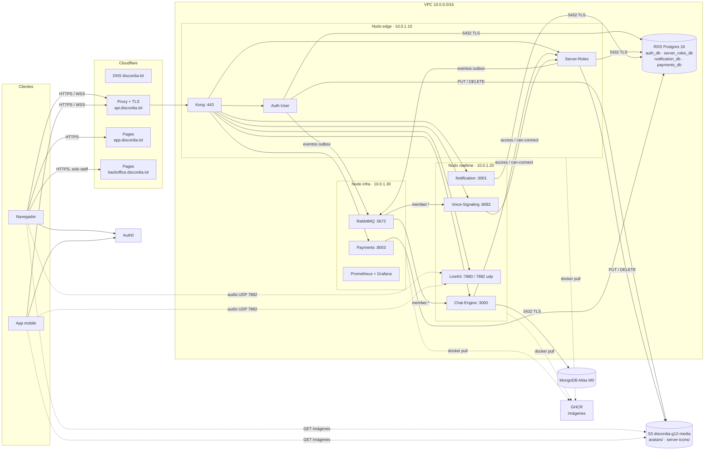
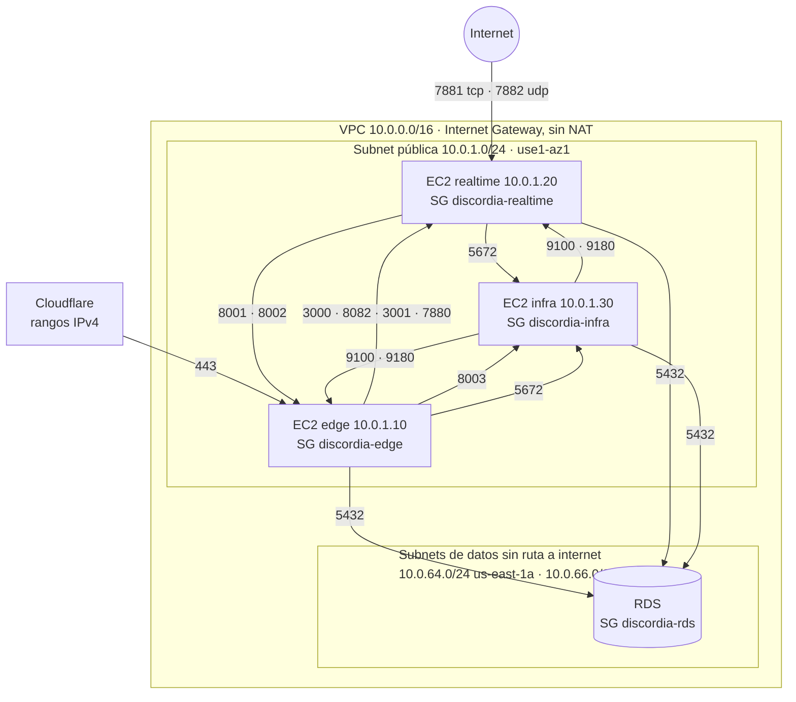
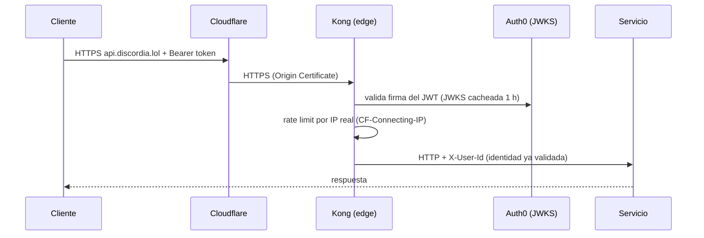
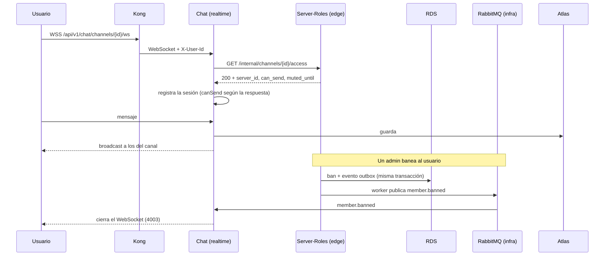
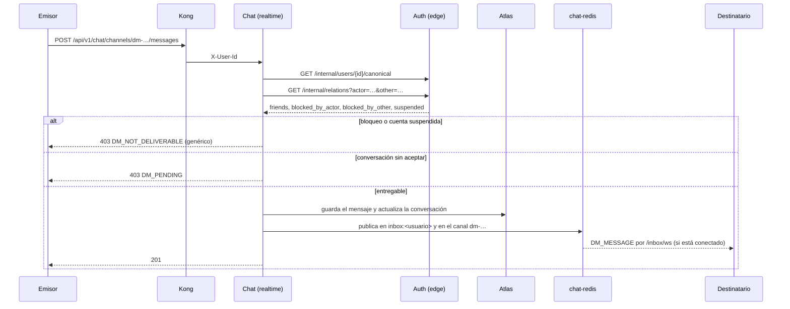
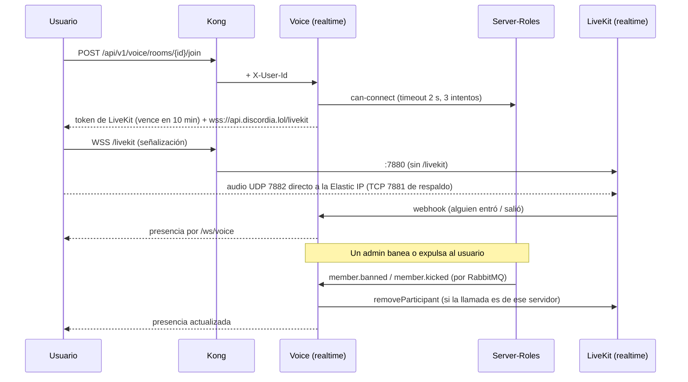
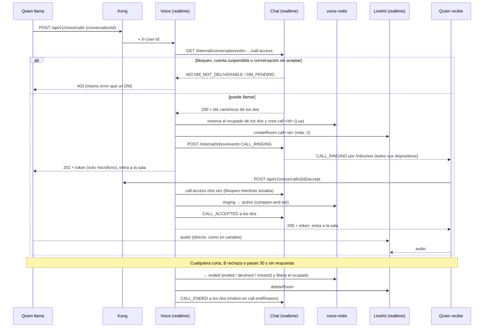
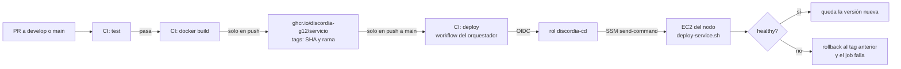
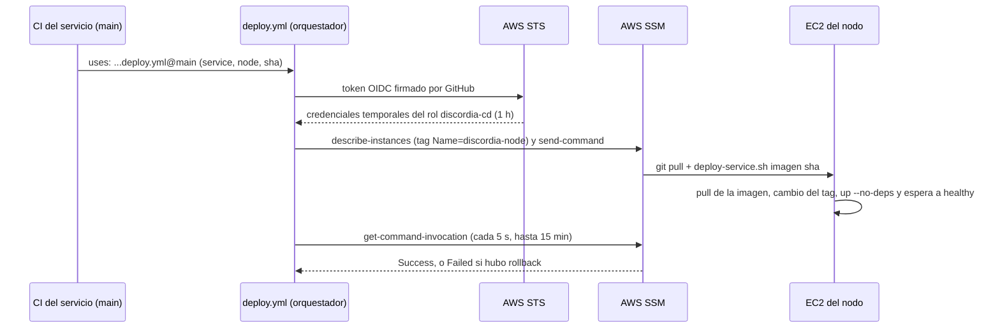

# Arquitectura y despliegue de Discordia

> Estado al 28/10/2026. Describe la arquitectura de tres nodos que reemplaza al monolito (una sola EC2 con
> `docker-compose.yml`), cómo se comunican los servicios, cómo se despliega y qué falta para el corte.
> Cambio del 16/10: **una sola VPC** (antes una por nodo con peering) y **todas las bases en el RDS** (antes
> un Postgres en contenedor por nodo).
> Cambio del 27/10: **despliegue automático desde `main`** (CD por OIDC + SSM, sección 11).

## Índice

1. [Resumen](#1-resumen)
2. [Vista general](#2-vista-general)
3. [Nodos y servicios](#3-nodos-y-servicios)
4. [Red y seguridad](#4-red-y-seguridad)
5. [Cómo se comunican los servicios](#5-cómo-se-comunican-los-servicios)
6. [Datos](#6-datos)
7. [Gateway (Kong)](#7-gateway-kong)
8. [Frontend y mobile](#8-frontend-y-mobile)
9. [Resiliencia: qué pasa si se cae un nodo](#9-resiliencia-qué-pasa-si-se-cae-un-nodo)
10. [Observabilidad](#10-observabilidad)
11. [Despliegue](#11-despliegue)
12. [Decisiones y alternativas descartadas](#12-decisiones-y-alternativas-descartadas)

---

## 1. Resumen

| Tema | Decisión |
|---|---|
| Cómputo | 3 EC2 (`t3.micro`), una por nodo: **edge**, **realtime**, **infra** |
| Red | **Una VPC** (`10.0.0.0/16`), una cuenta de AWS. Un **Security Group por nodo** + uno para el RDS. IPs privadas fijas |
| Entrada de la API | `api.discordia.lol` → **Cloudflare** (proxy, TLS) → **Kong** en edge (443, solo IPs de Cloudflare) |
| Frontend | SPA en **Cloudflare Pages** (`app.discordia.lol`) y backoffice del staff, otro proyecto de Pages (`backoffice.discordia.lol`, [ADR-002](../Gateway/docs/ADR-002-Rol-Staff-Backoffice.md)) |
| Bases relacionales | **Un RDS** (`discordia-db-cluster`, Postgres 18, `db.t4g.micro`) con una base por servicio. Ningún nodo corre Postgres |
| Historial del chat | **MongoDB Atlas M0** |
| Mensajería | **RabbitMQ** en infra; eventos publicados con el patrón **Outbox** |
| Audio de voz | **LiveKit** en realtime; el audio va directo por UDP 7882 (no pasa por Cloudflare) |
| Avatares, íconos y banners de servidor | **Bucket S3** `discordia-g12-media`: Auth y Server-Roles suben (los banners van en `server-icons/banners/`), los clientes leen directo del bucket ([ADR-003](../Auth-User-Service/docs/ADR-003-Avatares.md)) |
| Imágenes de contenedores | Cada repo las publica en **GHCR** desde su CI (tag = SHA del commit) |
| Despliegue | **Automático desde `main`**: el CI de cada servicio le ordena a su nodo, por **SSM**, que despliegue la imagen nueva, con healthcheck y rollback. GitHub entra a AWS por **OIDC**, sin claves guardadas |
| Ejecución | **Un solo `deploy/docker-compose.yml`** con un *profile* por nodo; cada EC2 levanta el suyo |
| Infraestructura | **Terraform** (`infra/terraform/`): VPC, subnets, Security Groups, EC2, bucket S3 y sus usuarios IAM, DNS y Pages. El RDS solo se **lee** (no lo administra) |
| Observabilidad | Prometheus + Grafana en infra; Node Exporter + cAdvisor en los tres nodos |

---

## 2. Vista general



---

## 3. Nodos y servicios

Cada nodo es una EC2 en la subnet pública de la VPC, con IP privada fija y su propio Security Group. 

### Edge — `10.0.1.10` (Elastic IP, origen de Cloudflare)

| Servicio | Imagen | Puerto publicado | Memoria |
|---|---|---|---|
| `gateway` (Kong 3.4) | `ghcr.io/discordia-g12/gateway` | 443 → 8443 (TLS), 127.0.0.1:8000, 8100 (métricas, solo infra) | 256 MB |
| `gateway-redis` | `redis:7-alpine` | — | 64 MB |
| `auth-service` | `ghcr.io/discordia-g12/auth-service` | 8001 → 8000 (solo realtime: Chat, ADR 0011) | 256 MB |
| `auth-outbox-worker` | misma imagen que Auth | — | 128 MB |
| `server-roles-service` | `ghcr.io/discordia-g12/server-roles-service` | 8002 → 8080 (temporal, solo realtime) | 256 MB |
| `server-roles-outbox-worker` | misma imagen que Server-Roles | — | 128 MB |

### Realtime — `10.0.1.20` (Elastic IP: `NODE_IP` de LiveKit y allowlist de Atlas)

| Servicio | Imagen | Puerto publicado | Memoria |
|---|---|---|---|
| `chat-engine-service` | `ghcr.io/discordia-g12/chat-engine-service` | 3000 | 256 MB |
| `chat-redis` | `redis:7-alpine` | — | 160 MB |
| `voice-signaling-service` | `ghcr.io/discordia-g12/voice-signaling-service` | 8082 → 8080 | 256 MB |
| `livekit` | `livekit/livekit-server:v1.13.7` | 7880, 7881/tcp, 7882/udp | 384 MB |
| `voice-redis` | `redis:7-alpine` | — | 64 MB |
| `notification-service` | `ghcr.io/discordia-g12/notification-service` | 3001 → 3000 | 128 MB |
| `chat-mongo` | `mongo:7.0` | — | 512 MB — **solo local** (profile `local`) |

### Infra — `10.0.1.30` (IP pública automática, solo para salir a internet)

| Servicio | Imagen | Puerto publicado | Memoria |
|---|---|---|---|
| `rabbitmq` | `rabbitmq:3-management-alpine` | 5672, 127.0.0.1:15672 (panel) | 320 MB |
| `payments-service` | `ghcr.io/discordia-g12/payments-service` | 8003 → 8000 | 192 MB |
| `prometheus` | `prom/prometheus:v2.53.0` | 127.0.0.1:9090 | 256 MB |
| `grafana` | `grafana/grafana-oss:11.6.0` | 127.0.0.1:3030 | 128 MB |

### RDS (fuera de los nodos, en la misma VPC)

| Dato | Valor |
|---|---|
| Identificador | `discordia-db-cluster` (ya existía; es el del monolito) |
| Motor / clase | Postgres 18 / `db.t4g.micro`, una sola zona (sin Multi-AZ) |
| Usuario | `discordia_admin` (el maestro), el mismo para las cuatro bases |
| Red | DB subnet group `discordia-data` (subnets privadas en `us-east-1a` / `use1-az1` y `us-east-1f`, donde vive el RDS), Security Group `discordia-rds`, sin IP pública |
| TLS | Obligatorio (`rds.force_ssl = 1`, default de Postgres 18) |

### S3 (fuera de la VPC)

| Dato | Valor |
|---|---|
| Bucket | `discordia-g12-media` (`us-east-1`), creado por Terraform (`infra/terraform/storage.tf`) |
| Contenido | `avatars/` (lo escribe Auth) y `server-icons/` (lo escribe Server-Roles). Cada archivo es un WebP de 256×256 con nombre único (`<prefijo>/<uuid>.webp`, `Cache-Control: immutable`) |
| Lectura | Pública solo en esos dos prefijos (bucket policy); el resto del bucket es privado y las ACLs están desactivadas |
| Escritura | Un usuario IAM por servicio (`discordia-auth-media`, `discordia-server-roles-media`) que solo puede hacer `PutObject` / `DeleteObject` en su prefijo. No se usa el rol de la EC2: el servicio funciona igual en cualquier nodo |
| Claves | Las access keys no las crea Terraform (quedarían en el estado): se crean con `terraform output media_access_key_commands` y van al `nodes.env` de edge (`AUTH_AWS_*`, `SERVER_ROLES_AWS_*`) |
| Configuración de los servicios | `S3_BUCKET`, `S3_PUBLIC_BASE_URL` (`terraform output media_bucket`), `AWS_REGION`, `AWS_ACCESS_KEY_ID`, `AWS_SECRET_ACCESS_KEY`. Sin bucket o sin claves, la subida responde 503 y el resto del servicio funciona igual |

El binario pasa por el servicio (lo valida y lo normaliza con Pillow) pero no se guarda en él: la base
guarda solo la URL pública (`user_profiles.avatar_url`, `servers.icon_url`). Los clientes cargan las
imágenes directo desde la URL del bucket, sin pasar por Kong.

### Solo en local (profile `local`)

| Servicio | Para qué |
|---|---|
| `chat-mongo` | Hace de Atlas |
| `local-postgres` (`postgres:18-alpine`) | Hace de RDS: se publica en el 5432 del host y crea las cuatro bases con `init-dbs.sql` |

### En los tres nodos

| Servicio | Puerto | Memoria |
|---|---|---|
| `node-exporter` (métricas de la máquina) | 9100 (solo infra) | 32 MB |
| `cadvisor` (métricas de cada contenedor) | 9180 (solo infra) | 96 MB |

### Fuera de AWS

| Servicio | Plan | Para qué |
|---|---|---|
| Cloudflare | Free | DNS, proxy y TLS de la API, Pages (SPA y backoffice) |
| Amazon S3 | (misma cuenta de AWS, fuera de la VPC) | Avatares e íconos de servidor |
| MongoDB Atlas | M0 | Historial del chat |
| Auth0 | (existente) | Identidad: login, tokens |
| GitHub / GHCR | Free | Código, CI, imágenes |

---

## 4. Red y seguridad



- **Una VPC** con una subnet pública (`10.0.1.0/24`) para las tres EC2 y dos subnets de datos
  (`10.0.64.0/24` en `us-east-1a`, `10.0.66.0/24` en `us-east-1f`) para el RDS. Las de datos no tienen ruta
  a internet; son dos porque AWS exige que un DB subnet group cubra al menos dos zonas. La de `us-east-1f`
  existe porque el RDS ya vivía en esa zona y al cambiarlo de VPC AWS no lo cambia de zona.
- **Sin NAT Gateway** (por un tema de costos mayormente): cada EC2 sale a internet con su IP pública y el Security Group
  bloquea la entrada.
- **El aislamiento lo dan los Security Groups, no la red**: cada nodo tiene el suyo y las reglas entre
  nodos apuntan al **grupo de origen** ("el RDS acepta 5432 del grupo de edge"), no a rangos de IP. Separar
  en VPCs no agregaba seguridad: con peering, lo que pasa o no pasa lo deciden igual los Security Groups.
- Las tres EC2 están en la misma zona (`us-east-1a` / `use1-az1`).
- **Sin SSH ni puerto 22**: se entra por **SSM Session Manager**.
- **IMDSv2 obligatorio**, disco cifrado, créditos de CPU en `standard` (si se agotan, la máquina se frena en
  vez de cobrar el excedente).

### Puertos abiertos (Security Groups)

Todo lo que no está en esta tabla está cerrado. El Admin API de Kong (8001 dentro de su contenedor, no es el 8001
del host, que es Auth), el panel de RabbitMQ,
Prometheus y Grafana **no se publican** (quedan en `127.0.0.1` del host; se accede con port forwarding de SSM).

| Security Group | Puerto | Desde | Para qué |
|---|---|---|---|
| `discordia-edge` | 443/tcp | Rangos de Cloudflare | Kong (API y WebSockets) |
| `discordia-edge` | 8002/tcp | grupo realtime | `access` / `can-connect` de Server-Roles (**temporal**) y conteos de las métricas globales |
| `discordia-edge` | 8001/tcp | grupo realtime | Chat → Auth: id canónico y relaciones (inbox y DMs, ADR 0011) |
| `discordia-edge` | 443/tcp | grupo realtime | Notification → `/internal/readyz/*` de Kong (estado de la plataforma; Kong solo acepta IPs privadas en esas rutas) |
| `discordia-realtime` | 3000, 8082, 3001/tcp | grupo edge | Kong → Chat, Voice, Notification |
| `discordia-realtime` | 7880/tcp | grupo edge | Kong → señalización de LiveKit (`/livekit`) |
| `discordia-realtime` | 7881/tcp, 7882/udp | 0.0.0.0/0 | Audio WebRTC (LiveKit valida su propio token) |
| `discordia-infra` | 5672/tcp | grupos edge y realtime | RabbitMQ (workers de outbox y consumidores) |
| `discordia-infra` | 8003/tcp | grupo edge | Kong → Payments |
| `discordia-edge`, `discordia-realtime` | 9100, 9180/tcp | grupo infra | Prometheus → Node Exporter y cAdvisor |
| `discordia-edge` | 8100/tcp | grupo infra | Prometheus → métricas de Kong (Status API) |
| `discordia-rds` | 5432/tcp | grupos edge, realtime e infra | Auth, Server-Roles, Notification, Payments → RDS |

### Cloudflare

| Registro | Tipo | Destino | Proxy |
|---|---|---|---|
| `api` | A | Elastic IP de edge | **Proxied** (nube naranja) |
| `app` | CNAME | `discordia-webapp.pages.dev` | Proxied |
| `backoffice` | CNAME | `discordia-backoffice.pages.dev` | Proxied |

- TLS público lo da Cloudflare; entre Cloudflare y Kong, **Origin Certificate** (modo **Full (strict)**).
- Kong solo acepta a Cloudflare (Security Group) y toma la IP real del usuario del header
  `CF-Connecting-IP` (`KONG_TRUSTED_IPS`), así el rate limiting es por usuario y no por IP de Cloudflare.
- Cloudflare corta los WebSockets inactivos (~100 s): por eso el **heartbeat** (sección 9).

---

## 5. Cómo se comunican los servicios

### Reglas generales

- **Dentro de un nodo**: por nombre de contenedor, en la red de Docker del nodo (`edge`, `realtime`,
  `infra`). Un contenedor **no ve** los de otro nodo.
- **Entre nodos**: a la **IP del host + puerto publicado**, como entre máquinas distintas. Las direcciones
  son variables: `EDGE_HOST`, `REALTIME_HOST`, `INFRA_HOST` (en local `host.docker.internal`; en
  producción las IPs privadas).
- **Desde los clientes**: todo entra por Kong (`api.discordia.lol`), salvo el audio (directo a LiveKit).

### Mapa de llamadas

| Origen | Destino | Tipo | Dirección |
|---|---|---|---|
| Kong | Auth, Server-Roles | HTTP | mismo nodo (`auth-service:8000`, `server-roles-service:8080`) |
| Kong | Chat (REST y WS), Voice (REST y `/ws/voice`), Notification, LiveKit | HTTP / WebSocket | `REALTIME_HOST:3000/8082/3001/7880` |
| Kong | Payments | HTTP | `INFRA_HOST:8003` |
| Chat | Auth `/internal/users/{id}/canonical` y `/internal/relations` | HTTP síncrono (timeout 2 s) | `EDGE_HOST:8001` — al abrir el inbox y en cada DM; si no responde, 503 |
| Chat | Server-Roles `/internal/channels/{id}/access` | HTTP síncrono | `EDGE_HOST:8002` — al abrir cada WebSocket y al pedir el historial |
| Chat | Server-Roles `/internal/servers/{id}/member-ids` | HTTP síncrono | `EDGE_HOST:8002` — al recibir `server.updated`, para avisar a los miembros por el inbox |
| Voice | Server-Roles `/internal/channels/{id}/can-connect` | HTTP síncrono (timeout + 3 reintentos) | `EDGE_HOST:8002` — al unirse a voz |
| Voice | Chat `/internal/conversations/{id}/call-access`, `/internal/users/{id}/canonical` | HTTP síncrono (timeout 2 s, 3 intentos) | mismo nodo (`chat-engine-service:3000`) — al iniciar, aceptar, rechazar o cortar una llamada privada; si no responde, iniciar y aceptar dan 503 |
| Voice | Chat `/internal/inbox/events` | HTTP síncrono (timeout 2 s, sin reintento) | mismo nodo — avisa `CALL_RINGING` / `CALL_ACCEPTED` / `CALL_ENDED` por el inbox de los dos |
| Notification | Chat `/internal/metrics/messages` | HTTP síncrono (timeout 2 s) | mismo nodo (`chat-engine-service:3000`) — métricas globales del backoffice; si no responde, ese dato sale en `null` |
| Notification | Server-Roles `/internal/metrics/servers` | HTTP síncrono (timeout 2 s) | `EDGE_HOST:8002` — métricas globales del backoffice; si no responde, ese dato sale en `null` |
| Auth / Server-Roles (workers) | RabbitMQ | AMQP (publica) | `INFRA_HOST:5672` |
| Chat | RabbitMQ | AMQP (consume `member.*`, `role.*`, `server.deleted`, `server.updated`, `channel.deleted`, `user.suspended`) | `INFRA_HOST:5672` |
| Voice | RabbitMQ | AMQP (consume `member.banned`, `member.kicked`, `member.left`, `user.suspended`) | `INFRA_HOST:5672` |
| Voice | LiveKit | API de servidor | mismo nodo (`livekit:7880`) |
| LiveKit | Voice `/webhooks/livekit` | Webhook HTTP | mismo nodo |
| Prometheus | Exportadores de los 3 nodos | HTTP (scrape) | `<NODO>_HOST:9100/9180` |
| Auth, Server-Roles, Notification, Payments | RDS | Postgres con TLS | `DB_HOST:5432` (endpoint del RDS, por la VPC) |
| Chat | MongoDB Atlas | TLS | internet (allowlist: Elastic IP de realtime) |
| Auth | Auth0 | HTTPS | internet |
| Auth, Server-Roles | S3 (`PutObject` / `DeleteObject` en su prefijo) | HTTPS con su usuario IAM | internet (sin NAT ni VPC endpoint: sale por la IP pública de edge) |
| Clientes | S3 (avatares e íconos) | HTTPS (`GET` público) | internet, directo al bucket (no pasa por Kong ni por Cloudflare) |

### Pedido a la API



Los servicios confían en el header `X-User-Id` que agrega Kong: **por eso nadie fuera de Kong puede llegar a
sus puertos** (Security Groups).

### Eventos (Outbox + RabbitMQ)

Los servicios que cambian datos guardan el evento en una tabla `outbox_events` **en la misma transacción**
que el cambio. Un worker aparte lo publica en RabbitMQ (al menos una vez; los consumidores deduplican por
`message_id`). Si RabbitMQ está caído, los eventos esperan en la base.

| Productor | Exchange (topic) | Eventos |
|---|---|---|
| Auth-User | `user.events` | `user.registered`, `user.profile.updated` |
| Server-Roles | `server.events` | `server.updated` (nombre, descripción, ícono o banner), `server.deleted`, `channel.created/updated/deleted`, `channels.reordered`, `category.created/updated/deleted`, `categories.reordered`, `role.permissions_updated`, `role.deleted`, `member.role_assigned/removed`, `member.left`, `member.kicked`, `member.banned/unbanned`, `member.muted/unmuted` |

| Consumidor | Cola | Binding | Qué hace |
|---|---|---|---|
| Chat-Engine | `chat_engine_events` (durable) | `member.*` | ban / kick / salida → cierra el WebSocket; mute / unmute → habilita o bloquea el envío |
| Chat-Engine | `chat_engine_events` (durable) | `server.updated` | Pide los miembros a Server-Roles y les manda `SERVER_UPDATED` por el inbox; el cliente vuelve a pedir sus servidores ([ADR 0013](../org-docs/docs/architecture/decisions/0013-cambios-de-servidor-en-vivo.md)) |
| Voice-Signaling | `voice_signaling_events` (durable) | `member.banned`, `member.kicked`, `member.left` | Saca al usuario de la llamada de ese servidor y lo bloquea para que no vuelva a entrar con un token viejo |
| Voice-Signaling | `voice_signaling_events` (durable) | `user.suspended` (`user.events`) | Saca la cuenta de los canales de voz y termina su llamada privada (`unavailable`) |

**Ver y escribir son permisos distintos** en el chat: `/internal/channels/{id}/access` responde 403 si el
usuario no es miembro, está baneado o no tiene `VIEW_CHANNELS`. Si puede ver, devuelve `can_send`
(`SEND_MESSAGES` y sin mute vigente) y `muted_until`. Un usuario muteado abre el canal y lee el historial,
pero no puede escribir; al abrir el WebSocket recibe `{ "type": "PERMISSIONS_UPDATED", "canSend": false }`
y, si el mute tiene vencimiento, el chat lo habilita solo cuando vence.

### Mensaje de chat y ban en vivo



### Mensaje directo

Decisión completa en
[ADR 0011](../org-docs/docs/architecture/decisions/0011-mensajes-directos.md). Un DM usa las rutas de canal
con un id `dm-<ObjectId>`: `channelAccessGuard` valida que sea participante y no consulta a Server-Roles. La
relación se revisa en cada envío, nunca se cachea en el socket.



Si el destinatario no está conectado, el mensaje queda en Atlas y aparece en `unreadCount` de
`GET /conversations`, que el cliente vuelve a pedir al reconectar. La presencia es una clave en `chat-redis`
con TTL de 60 s que renueva el heartbeat del inbox.

### Voz



Voice guarda en Redis de qué servidor es cada llamada (`user:{id}:voice_server`, `channel:{id}:server`).
Al recibir un ban, una expulsión o una salida, saca al usuario de la sala solo si la llamada es de ese
servidor, y guarda un bloqueo (`voice:blocked:{servidor}:{usuario}`, 24 h). Si el usuario entra a una sala
de ese servidor con un token emitido antes, el webhook `participant_joined` lo saca. El bloqueo se borra
cuando vuelve a pasar por `/join` (que chequea `can-connect`).

### Llamada privada

Decisión completa en
[ADR 0015](../org-docs/docs/architecture/decisions/0015-llamadas-privadas.md). Una llamada 1 a 1 es una
sala de LiveKit `call-<id>` de 2 personas, separada de los canales de voz. Voice no decide si se puede llamar:
le pregunta a Chat, que aplica las mismas reglas que a un DM, y el aviso viaja por el inbox de Chat.



- **Ocupado:** si cualquiera de los dos ya tiene una llamada sonando o activa, `409 CALL_BUSY`.
- **Sin cortar:** si alguien se va de la sala (cerró la pestaña, se quedó sin red), el webhook de LiveKit la
  termina (`canceled` si sonaba, `ended` si estaba activa). Los webhooks de salas `call-` no tocan la presencia
  de los canales.
- **Chat caído:** iniciar y aceptar dan 503 y no se crea nada; rechazar y cortar siguen andando con la
  identidad guardada en la llamada (el aviso de fin se pierde y se loguea).

---

## 6. Datos

| Dato | Dónde | Detalle |
|---|---|---|
| `auth_db` | RDS | La usa Auth-User (edge) |
| `server_roles_db` | RDS | La usa Server-Roles (edge) |
| `notification_db` | RDS | La usa Notification (realtime): `incidents` y `audit_logs`, creadas por sus migraciones al arrancar ([ADR-03](../Notification-Audit-Metrics-Service/docs/ADR-03-Incidentes-y-migraciones.md)) |
| `payments_db` | RDS | La usa Payments (infra) |
| Historial del chat y conversaciones directas | MongoDB Atlas M0 | En local, `chat-mongo` (profile `local`) |
| Amistades, solicitudes de amistad y bloqueos | `auth_db` (RDS) | `friendships`, `friend_requests`, `user_blocks`, siempre con el id canónico |
| Avatares | S3 `discordia-g12-media/avatars/` | Los sube Auth; la URL queda en `auth_db` (`user_profiles.avatar_url`) |
| Íconos de servidor | S3 `discordia-g12-media/server-icons/` | Los sube Server-Roles; la URL queda en `server_roles_db` (`servers.icon_url`) |
| Sesiones de voz, presencia, llamadas privadas | `voice-redis` (realtime) | Local al nodo. Llamadas: `call:<id>`, `call:user:<id>` (ocupado) y `call:identity:<id>`, con TTL (45 s sonando, 12 h activa) |
| Pub/sub del chat, inbox de DMs y presencia | `chat-redis` (realtime) | `noeviction` |
| Rate limiting y cuentas suspendidas | `gateway-redis` (edge) | `volatile-lru`: las suspensiones las escribe Auth y las lee Kong; la clave por email no tiene TTL y nunca se descarta ([ADR-002 de Auth-User](../Auth-User-Service/docs/ADR-002-Suspension-Usuarios.md)) |
| Eventos | RabbitMQ (infra) | Volumen persistente `rabbitmq-data` |

- **Una base por servicio, en una sola instancia**: ningún servicio lee la base de otro (se hablan por
  eventos).
- **Un solo usuario** (`discordia_admin`) para las cuatro. 
- **TLS**: Postgres 18 en RDS lo exige. Los servicios Python (asyncpg, psycopg2) lo negocian solos; el de
  Node (Notification) necesita `sslmode=no-verify` en la URL (`NOTIFICATION_DB_SSLMODE`): cifra pero no valida
  el certificado, porque Node no trae la CA de Amazon. CHEQUEAR SI hay que: montar el bundle de la CA de RDS y
  usar `verify-full`.
- **Backups**: los automáticos del RDS (snapshots diarios y restauración a un punto en el tiempo).
- En local, `local-postgres` (profile `local`) hace de RDS con las mismas bases (`init-dbs.sql`).

**Importante:** RabbitMQ y Grafana toman usuario y contraseña **solo la primera vez que arrancan** (con el
volumen vacío). Si después se cambia el valor en `nodes.env`, hay que cambiarlo también adentro
(`rabbitmqctl change_password`, etc.). Ver sección 15.

---

## 7. Gateway (Kong)

- `Gateway/kong.yml` es una **plantilla**: los destinos son variables (`${CHAT_ENGINE_URL}`, ...).
  `Gateway/render-config.sh` las completa al arrancar el contenedor; si queda alguna sin completar, Kong no
  arranca. Sin variables usa los nombres del compose local.
- La configuración (plantilla, `.lua`, `nginx/`) va **dentro de la imagen**.
- Rutas:

| Ruta | Destino | Auth |
|---|---|---|
| `/api/v1/users`, `/api/v1/profile` | Auth-User | JWT |
| `/api/v1/auth/password-reset` | Auth-User | pública + rate limit |
| `/api/v1/servers`, `/channels`, `/roles`, `/moderation`, `/invites` | Server-Roles | JWT |
| `/api/v1/chat` (REST y WebSocket) | Chat-Engine | JWT |
| `/api/v1/voice`, `/ws/voice` | Voice-Signaling | JWT |
| `/livekit` | LiveKit (señalización, sin el prefijo) | token propio de LiveKit |
| `/api/v1/payments`, `/points`, `/boosts` | Payments | JWT + rate limit |
| `/api/v1/notifications` | Notification | JWT |
| `/api/v1/audit`, `/metrics`, `/admin/status`, `/admin/incidents`, `/admin/metrics` | Notification | JWT + rol staff ([ADR-002](../Gateway/docs/ADR-002-Rol-Staff-Backoffice.md)) |
| `/api/v1/status` | Notification | pública (estado e incidentes activos) |
| `/livez`, `/readyz` | Kong | pública |

- En producción (`deploy/gateway.env`): TLS con el Origin Certificate (`KONG_SSL_CERT`), `KONG_TRUSTED_IPS`
  (rangos de Cloudflare, `terraform output -raw cloudflare_trusted_ips`), `KONG_REAL_IP_HEADER=CF-Connecting-IP`.
  Admin API solo en `127.0.0.1` del contenedor.

---

## 8. Frontend y mobile

- **Web**: Cloudflare Pages compila `Discordia-WebApp` en cada push a `main` (`npm run build`, Node 22) y
  sirve `dist/`. Variables de build: `VITE_API_URL=https://api.discordia.lol` y `VITE_AUTH0_*` (públicas).
  Sin previews por PR (apuntarían a la API de producción). Headers de seguridad y caché en `public/_headers`.
- **Backoffice**: otro proyecto de Pages (`discordia-backoffice`) sobre el mismo repo: compila
  `npm run build:backoffice` y sirve `apps/backoffice/dist` en `backoffice.discordia.lol`. Usa su propia
  aplicación de Auth0 (`VITE_AUTH0_CLIENT_ID` = variable `auth0_backoffice_client_id` de Terraform) y headers
  más estrictos (`apps/backoffice/public/_headers`). Solo entra el staff ([ADR-002](../Gateway/docs/ADR-002-Rol-Staff-Backoffice.md)).
- **Mobile**: `eas.json` fija `EXPO_PUBLIC_API_URL=https://api.discordia.lol` en los perfiles `preview` y
  `production`.
- **Reconexión**: la web (`useChatWebSocket`) y mobile (`useChannelSocket`) se reconectan solas con backoff
  exponencial y recuperan los mensajes perdidos durante el corte.

---

## 9. Resiliencia: qué pasa si se cae un nodo

| Se cae | Sigue funcionando | Deja de funcionar |
|---|---|---|
| **infra** | Login, servidores, canales, chat y voz | Payments; eventos en vivo (bans y mutes se aplican al volver: quedan en la cola o en el outbox); métricas |
| **realtime** | Login, servidores, canales, roles, Payments | Chat, voz, notificaciones, estado y métricas globales del backoffice |
| **edge** | Nada desde afuera (es la única entrada) | Toda la API. Los WebSockets abiertos se cortan |
| **RDS** | Chat ya abierto (mensajes en Atlas) y voz ya conectada | Login, servidores, canales, permisos (nuevos WebSockets y joins de voz fallan en `access` / `can-connect`), notificaciones y Payments |
| **S3** | Todo lo demás | Subir avatar y crear un servidor con ícono (503, sin dejar nada a medias); las imágenes no se ven |

**El RDS es el punto único de falla de los datos relacionales.** Se aceptó a cambio de no administrar
Postgres en tres máquinas.

Mecanismos:

- **Heartbeat**: Chat (`/channels/:id/ws`) y Voice (`/ws/voice`) mandan un ping de protocolo cada 30 s y
  cierran las conexiones que no responden. Evita el corte de Cloudflare a los ~100 s.
- **Consumidor del chat**: no bloquea el arranque, reintenta para siempre con backoff (1 s → 30 s) y se
  reconecta si RabbitMQ se cae. `/readyz` del chat informa `rabbitmq: ok | disconnected` **sin** marcarse
  no-ready (para no propagar una caída de infra).
- **Outbox**: si RabbitMQ no está, los eventos esperan en la base del productor (en el RDS).
- **Voice → Server-Roles**: timeout de 2 s y 3 intentos; si no responde, el join da 503 (ADR-03 de Voice).
- **Chat → Auth**: los DMs **fallan cerrados**: si Auth no responde, 503 y no se entrega nada. Los canales no
  dependen de Auth y siguen funcionando.
- **Voice → Chat** (llamadas privadas): timeout de 2 s y 3 intentos en las lecturas. Sin Chat no se puede
  iniciar ni aceptar una llamada (503); cortar sigue andando. Chat no entra en el `/readyz` de Voice: los
  canales de voz no dependen de Chat (ADR-04 de Voice).
- **`restart: unless-stopped`** y healthchecks en todos los contenedores.

**Dependencias síncronas que quedan**: Chat y Voice consultan a Server-Roles (edge) al abrir un WebSocket o
unirse a voz, Chat consulta a Auth (edge) en cada DM, y Voice consulta a Chat (mismo nodo) en cada llamada
privada. Si edge cae, ya no importa (tampoco hay API). La de Server-Roles se puede eliminar con la "foto de
permisos por eventos" (pendiente, P1 en `DEUDA-TECNICA.md`).

---

## 10. Observabilidad

Tres niveles, en el orden de ADR-O2 (`observability/docs/`): recursos → comportamiento → negocio. Los dos
primeros van a Prometheus; el de negocio no (sale de eventos que consume Notification).

- **Prometheus** (infra) lee por IP:puerto:
  - los **Node Exporter** (9100) y **cAdvisor** (9180) de los tres nodos;
  - las métricas de **Kong** (plugin `prometheus` en la Status API, 8100 de edge), que dan el RED del
    gateway por servicio de Kong (`upstream`) y ruta;
  - el plugin de Prometheus de **RabbitMQ**.

  La configuración está en `deploy/observability/prometheus.yml.tmpl` (las IPs se completan al arrancar).
  Retención: 7 días o 2 GB. Los servicios todavía no exponen `/metrics` propio (deuda O1).
- **Alertas**: reglas de Prometheus del submódulo (`observability/prometheus/rules/`): target caído, OOM,
  reinicios, memoria cerca del límite, memoria y disco del host, 5xx del gateway. **No hay Alertmanager**
  (ADR-O4): se ven en *Alerts* de Prometheus y en el Overview de Grafana, nadie recibe un aviso (deuda O2).
- **Grafana** (infra) usa el datasource y los dashboards del submódulo `observability`, provisionados por
  archivo (no se editan desde la UI) y ordenados en carpetas por nivel: *Overview*, *Recursos* (variables
  `node` y `service`) y *Comportamiento*.
- **Estado de la plataforma** (historia 74): Notification sondea cada 15 s los `/readyz` de todos los
  servicios a través de Kong (`/internal/readyz/*`, solo IPs privadas) y los sirve desde memoria:
  - `GET /api/v1/status` es público: da el estado combinado con los incidentes activos (operativo, degradado o
    en mantenimiento) y los incidentes;
  - `GET /api/v1/admin/status` es staff (Kong y el servicio) y suma la latencia y el motivo;
  - `/api/v1/admin/incidents` (staff) publica, lista y resuelve incidentes, guardados en `notification_db` con
    su registro en `audit_logs` ([ADR-03](../Notification-Audit-Metrics-Service/docs/ADR-03-Incidentes-y-migraciones.md)).

  La web consulta el estado público cada 60 s y muestra un aviso mientras haya incidentes activos. El
  backoffice sugiere publicar uno cuando un servicio queda degradado y ningún incidente lo cubre.

- **Métricas globales** (backoffice, [ADR 0014](../org-docs/docs/architecture/decisions/0014-metricas-globales-de-la-plataforma.md)):
  `GET /api/v1/admin/metrics?from&to` (staff, Kong y el servicio) devuelve usuarios activos, servidores
  creados y mensajes enviados en el período. Notification no guarda nada: pide los conteos en el momento a
  Chat (mensajes y autores distintos) y a Server-Roles (servidores creados). Usuario activo = envió al menos
  un mensaje, en un canal o por DM. Si uno no responde, devuelve el resto con `partial: true`.

  El backoffice muestra la versión staff y un link a Grafana. Grafana **no se embebe ni se publica**: la
  autorización del backoffice la hace el backend (ADR-002 del Gateway) y Grafana tiene su propio login.
- **Fallas de observabilidad**: Prometheus, Grafana y los exportadores son opcionales en el deploy (§11).
- Acceso a Grafana y Prometheus (no están publicados):

```bash
aws ssm start-session --target <id de infra> --document-name AWS-StartPortForwardingSession \
  --parameters portNumber=3030,localPortNumber=3030      # Grafana → http://localhost:3030
aws ssm start-session --target <id de infra> --document-name AWS-StartPortForwardingSession \
  --parameters portNumber=9090,localPortNumber=9090      # Prometheus → http://localhost:9090
```

---

## 11. Despliegue

Hay un solo entorno, **producción**, y se despliega solo desde `main`. `develop` integra y publica imágenes,
pero no despliega. Un push a `main` de un servicio despliega ese servicio; un push a `main` del orquestador
que toca la configuración (compose, LiveKit, RabbitMQ, observabilidad) la aplica en los tres nodos. Nadie
entra a una EC2 para desplegar.

### Del commit al nodo



- **CI por repo** (`.github/workflows/ci.yml`), tres jobs encadenados con `needs`:
  - `test`: lint, tests y análisis estático;
  - `docker`: en push a `main` o `develop`, construye la imagen y la publica en GHCR. En los PRs no corre
    (salvo los de Dependabot que cambian la imagen base, donde solo la construye), para ahorrar minutos de
    Actions; en Gateway sí corre en los PRs, porque valida `kong.yml` con Kong, pero sin el segundo build;
  - `deploy`: solo en push a `main`, llama al workflow reutilizable del orquestador.

  Si los tests fallan, no hay imagen, y sin imagen no hay deploy. Un push nuevo a un PR cancela el run
  anterior del mismo PR (`concurrency`); los push a `main`/`develop` nunca se cancelan.
- Etiquetas de la imagen: **SHA completo del commit** (40 caracteres: lo que se despliega, no cambia) y nombre
  de la rama. Sin `latest`.
- La SPA no usa imagen: Cloudflare Pages publica la web desde `main` de Discordia-WebApp.

| Repo | Imagen | Nodo | Contenedores que reinicia |
|---|---|---|---|
| Gateway | `gateway` | edge | `gateway` |
| Auth-User-Service | `auth-service` | edge | `auth-service`, `auth-outbox-worker` |
| Server-Roles-Core-Service | `server-roles-service` | edge | `server-roles-service`, `server-roles-outbox-worker` |
| Chat-Engine-Service | `chat-engine-service` | realtime | `chat-engine-service` |
| Voice-Signaling-Session-Service | `voice-signaling-service` | realtime | `voice-signaling-service` |
| Notification-Audit-Metrics-Service | `notification-service` | realtime | `notification-service` |
| Payments-Monetization-Service | `payments-service` | infra | `payments-service` |

### Deploy de un servicio



**Workflow reutilizable** (`.github/workflows/deploy.yml` del orquestador, `on: workflow_call`):

1. Valida los inputs (`service`, `node`, `sha`). Entran al script por variables de entorno y no con `${{ }}`
   dentro de `run`, para que no se puedan inyectar comandos.
2. Pide credenciales con `aws-actions/configure-aws-credentials` y el rol `discordia-cd`. El ARN está fijo
   en el workflow: no es un secreto, y una variable de organización necesita permisos de admin de la org.
3. Busca la instancia por su tag `Name=discordia-<nodo>`, sin IDs fijos en el código. Si no hay exactamente
   una corriendo, falla.
4. Manda por SSM (`AWS-RunShellScript`) un `git pull` de `/opt/discordia`, para correr la versión del script
   que está en `main`, y después `deploy-service.sh <imagen> <sha>`.
5. Espera el resultado y muestra la salida del nodo en el log del job. No usa `aws ssm wait`, que se corta a
   los 100 s. Si el comando no termina en `Success`, el job falla.

Dos deploys del mismo repo no se pisan (`concurrency` por repo). Entre repos distintos, el lock lo pone el
script en el nodo.

**Script del nodo** (`deploy/deploy-service.sh`, corre como root):

1. Valida que la imagen sea una de las siete, que corresponda a este nodo (`/etc/discordia/node-name`) y que
   el SHA tenga 40 caracteres hexadecimales.
2. Toma el lock del nodo (`flock`): los servicios de un mismo nodo comparten `nodes.env`.
3. Baja la imagen nueva **antes** de tocar `nodes.env`. Si no existe en GHCR, no cambia nada.
4. Guarda el tag anterior, escribe `<SERVICIO>_TAG=<sha>` en `nodes.env` y corre
   `up -d --no-build --no-deps` solo con los contenedores de ese repo.
5. Espera hasta 120 s (`HEALTH_TIMEOUT`) a que todos queden `healthy`. Si alguno no llega, muestra sus logs,
   vuelve al tag anterior, lo levanta de nuevo y sale con error.
6. Registra el resultado en `/var/log/discordia-deploy.log`: `ok`, `rolled-back`, `rollback-failed` o
   `pull-failed`.

Los healthchecks de los servicios en el compose usan `/readyz`: un servicio que arranca pero no llega a su base o a RabbitMQ
no queda `healthy`, y el deploy vuelve atrás.

**Migraciones.** Auth-User corre `alembic upgrade head`; Notification aplica las suyas al arrancar, antes de
escuchar ([ADR-03](../Notification-Audit-Metrics-Service/docs/ADR-03-Incidentes-y-migraciones.md)). Si una
falla, el contenedor no queda `healthy` y el deploy vuelve al tag anterior. El rollback no deshace el esquema:
las migraciones tienen que ser aditivas para que la imagen anterior siga arrancando.

### Deploy de la configuración

`.github/workflows/deploy-config.yml` corre en push a `main` del orquestador cuando cambia `deploy/**`
(salvo `README.md` y los `*.example`), `livekit/**`, `rabbitmq/**` o el puntero del submódulo
`observability`. También se puede correr a mano (`workflow_dispatch`), por ejemplo después de arreglar un
nodo.

- Usa el mismo rol y el mismo mecanismo de SSM que el deploy de servicios.
- Recorre los nodos en orden **infra → realtime → edge**. Si uno falla, los siguientes no se tocan.
- En cada nodo corre `deploy/deploy-config.sh <sha>`, tomado del commit que se despliega (`git show`): el
  que está en el nodo puede ser viejo.

El script (`deploy/deploy-config.sh`):

1. Verifica que `/opt/discordia` esté en `main`, sin cambios locales, y que el commit esté en `main`.
2. Lleva el repo a ese commit (solo fast-forward) y actualiza el submódulo `observability`.
3. Corre `up -d --no-build` de todo el nodo: Compose recrea los contenedores cuya definición cambió.
4. Recrea a mano los que montan un archivo que cambió, porque Compose no se entera de eso: `livekit`,
   `rabbitmq`, `prometheus` o `grafana`, y solo si son de ese nodo.
5. Espera hasta 180 s a que todo el nodo quede `healthy` (o `running`, si no tiene healthcheck). Si no,
   vuelve al commit anterior. Los servicios con el label `discordia.deploy.optional=true` (Prometheus,
   Grafana, Node Exporter, cAdvisor) se esperan igual, pero si no quedan sanos solo se avisa en el log: una
   falla de observabilidad no revierte el nodo (ni los cambios de RabbitMQ que vinieran en el mismo commit).
6. Guarda el último commit aplicado en `/etc/discordia/config-sha`. No alcanza con el `HEAD` del repo: el
   deploy de un servicio también hace `git pull`, y puede traer un `livekit.yaml` nuevo sin recrear
   `livekit`.

Comparte el lock y el log con `deploy-service.sh` (en el log aparece como `image=config`).

Como el deploy ya no frena un Prometheus roto, la configuración se valida antes:
`.github/workflows/validate-config.yml` (PR y push a `develop`) corre `docker compose config` y
`promtool check config` sobre la plantilla. Las reglas de alerta las valida el CI de `observability`
(`promtool check rules` y `test rules`).

### Seguridad del deploy

- **Sin claves guardadas en GitHub.** GitHub Actions entra a AWS por **OIDC**: cada run recibe un token
  firmado por GitHub y lo cambia por credenciales temporales de una hora.
- **Sin SSH ni puerto 22.** El comando llega a la EC2 por **SSM**.
- **El rol `discordia-cd` solo lo puede asumir `main`** de los repos de `local.cd_repos`: los siete servicios
  y el orquestador. Es una lista explícita, así que la WebApp y `observability` no pueden desplegar.
  GitHub firma el `sub` en formato inmutable (`repo:discordia-g12@<id org>/<repo>@<id repo>:ref:refs/heads/main`):
  renombrar un repo no le da acceso a otro.
- **Permisos mínimos:**
  - `ssm:SendCommand`, solo sobre las tres instancias y el documento `AWS-RunShellScript`;
  - `ssm:GetCommandInvocation`, `ssm:ListCommandInvocations` y `ec2:DescribeInstances` (no admiten
    permisos por recurso).
- Las EC2 bajan las imágenes de GHCR con un `docker login` de solo lectura (`read:packages`) y hacen
  `git pull` con un credential store de root.

### Un compose, tres nodos

`deploy/docker-compose.yml` define los tres nodos. Qué se levanta lo decide `COMPOSE_PROFILES`:

| Dónde | `COMPOSE_PROFILES` |
|---|---|
| Local (los tres juntos) | `edge,realtime,infra,local` |
| EC2 edge / realtime / infra | `edge` / `realtime` / `infra` |

Archivos:

| Archivo | Para qué |
|---|---|
| `deploy/docker-compose.yml` | Servicios, redes por nodo, límites, healthchecks |
| `deploy/deploy-service.sh` | Deploy de un servicio en su nodo (lo llama el CD) |
| `deploy/deploy-config.sh` | Deploy de la configuración en un nodo (lo llama el CD) |
| `deploy/.env.example` | Variables: local y la lista completa de producción por nodo |
| `deploy/gateway.env.example` | Solo edge: TLS e IPs de confianza de Cloudflare |
| `deploy/observability/prometheus.yml.tmpl` | Destinos de Prometheus y carga de las reglas de alerta |
| `.github/workflows/deploy.yml` | Workflow reutilizable del deploy de servicios |
| `.github/workflows/deploy-config.yml` | Deploy de la configuración |
| `.github/workflows/validate-config.yml` | Valida el compose y la plantilla de Prometheus antes de `main` |
| `init-dbs.sql` (raíz) | Solo local: crea las cuatro bases en `local-postgres` |
| `infra/terraform/` | Infraestructura (ver abajo) |

### Configuración de cada EC2

- Código: `/opt/discordia`, un clon del orquestador en `main` con el submódulo `observability`.
- Nombre del nodo: `/etc/discordia/node-name` (`edge`, `realtime` o `infra`; lo escribe cloud-init).
- Variables y secretos: `/etc/discordia/nodes.env` (permisos 600). Contiene:
  - `COMPOSE_PROFILES`, `REGISTRY` y un `<SERVICIO>_TAG` por servicio (lo actualiza el CD);
  - `EDGE_HOST`, `REALTIME_HOST` e `INFRA_HOST`;
  - el RDS (`DB_HOST`, `DB_USER`, `DB_PASSWORD`; en realtime también `NOTIFICATION_DB_SSLMODE=no-verify`);
  - los secretos del nodo.

  Generar los secretos con `openssl rand -hex 32` (no `-base64`: sus `/ + =` rompen las URLs).
- Estado del CD: `/etc/discordia/config-sha` (última configuración aplicada), `/var/log/discordia-deploy.log`
  (historial de deploys) y `/var/lock/discordia-deploy.lock`.
- Atajo para Compose: `/usr/local/bin/dcn` (no `dc`, que es una calculadora del sistema):

```bash
#!/bin/sh
exec docker compose -f /opt/discordia/deploy/docker-compose.yml --env-file /etc/discordia/nodes.env "$@"
```

- Levantar un nodo desde cero: `dcn pull && dcn up -d --no-build && dcn ps`. Orden: **infra → realtime → edge**.

### Operación

| Necesito... | Cómo |
|---|---|
| Desplegar un servicio | Merge a `main` de su repo |
| Desplegar la configuración | Merge a `main` del orquestador. Para volver a aplicarla: *Actions → Deploy config → Run workflow* |
| Ver qué pasó en un deploy | El log del job `deploy` (trae la salida del nodo) o `/var/log/discordia-deploy.log` en el nodo |
| Volver a una versión anterior | `git revert` en `main` del repo: el CD despliega el revert y `main` sigue reflejando lo que corre |
| Desplegar a mano (emergencia) | En el nodo, por SSM: `sudo /opt/discordia/deploy/deploy-service.sh <imagen> <sha>`. El próximo push a `main` lo pisa |
| Saber qué versión corre | `grep _TAG /etc/discordia/nodes.env` en el nodo, o `dcn ps` |

Entrar a un nodo: `aws ssm start-session --target <id>` (`terraform output ssm_connect`). En un nodo cuyo
`origin/main` está viejo, primero `git fetch` y después `git checkout -B main origin/main`: un
`git checkout main` directo puede dejar un commit viejo del monolito.

### Limitaciones conocidas

- **`main` no está protegida.** La organización está en el plan Free y los repos son privados: GitHub no
  permite protección de ramas ni rulesets. Mientras tanto, `deploy` depende de `test` y `docker` (`needs`):
  un cambio con tests rotos no llega a producción, aunque el merge no quede bloqueado.
- **El rollback es por healthcheck.** Detecta un servicio que no arranca o no está listo, no un error de
  lógica: para eso está el `git revert`.
- **Un rollback de configuración no cambia `main`.** El nodo vuelve al commit anterior, pero el próximo
  `git pull` (por ejemplo, el deploy de un servicio) vuelve a traer el commit roto. Hay que corregirlo en
  `main`.
- **Sin despliegue sin corte.** Hay una sola instancia de cada servicio: mientras se recrea el contenedor (unos
  segundos), ese servicio no responde. Los clientes reconectan el WebSocket solos.
- **El estado de Terraform es local** (deuda I1 en `DEUDA-TECNICA.md`): el rol `discordia-cd` lo aplica
  quien tiene el `terraform.tfstate`.
- **El puerto 8001 necesita `terraform apply` antes del deploy.** El CD no aplica Terraform: si el compose con
  `AUTH_SERVICE_URL` llega a realtime sin la regla en el Security Group, los DMs fallan cerrados (503). Los
  canales no se enteran.
- **Llamadas privadas: Chat antes que Voice.** Voice nuevo con Chat viejo (sin
  `/internal/conversations/{id}/call-access`) no puede iniciar llamadas: Chat responde 404 sin `code` a la ruta
  que no conoce y Voice lo toma como Chat no disponible (`503 CHAT_UNAVAILABLE`). No se crea nada y el resto de
  la voz no se entera. `CHAT_SERVICE_URL` no necesita Terraform: Voice y Chat están en el mismo nodo.

### Terraform

```
infra/terraform/
├── network.tf       VPC, Internet Gateway, subnet pública, subnets de datos, DB subnet group
├── security.tf      Security Group por nodo + RDS, y todas las reglas de entrada
├── main.tf          los 3 nodos, lectura del RDS (data source), budget, registro DNS api
├── iam-cd.tf        proveedor OIDC de GitHub y rol discordia-cd para el deploy por SSM
├── pages.tf         proyectos de Cloudflare Pages (web y backoffice) + dominios app y backoffice + CNAME
├── storage.tf       bucket S3 de imágenes, policy de lectura pública por prefijo, usuario IAM por servicio
├── providers.tf     AWS (un perfil) + Cloudflare
├── variables.tf · locals.tf · outputs.tf · versions.tf
└── modules/
    └── node/        EC2, Elastic IP, rol SSM, cloud-init
```

- **El RDS no lo crea ni lo borra Terraform**: lo lee con un `data "aws_db_instance"` (para el endpoint) y
  crea el subnet group y el Security Group adonde se lo mueve. Moverlo es un comando aparte
  (`terraform output -raw rds_move_command`), así ningún `terraform destroy` puede borrar la base.
- **Estado local** (`terraform.tfstate`, no se commitea): tiene que aplicarlo una sola persona y guardar
  una copia. Alternativa: HCP Terraform (bloque `cloud` comentado en `versions.tf`).
- **DNS**: Terraform administra `api`, `app` y `backoffice` de `discordia.lol` (`manage_dns = true`, el
  default). Los registros de `api` y `app` y el dominio de Pages de la app se crearon antes de que estuvieran
  en este state y se importaron (`terraform import`). **No poner `manage_dns = false`**: el próximo `apply`
  los borraría de Cloudflare.
- Un **budget de $1 sobre el gasto neto** (avisa si algo se cobra fuera de los créditos).
- `terraform output`: IPs de cada nodo, comandos de SSM, `rds_endpoint`, `rds_move_command`,
  `cloudflare_trusted_ips`, `media_bucket` (`S3_BUCKET` y `S3_PUBLIC_BASE_URL`),
  `media_access_key_commands` (crear o rotar las claves de cada servicio) y `cd_role_arn`.
- Para sumar un repo que despliega: agregarlo con su ID a `cd_repos` (`locals.tf`) y aplicar
  (`gh api repos/discordia-g12/<repo> -q .id`).

### Local (simular los tres nodos)

```bash
cp deploy/.env.example deploy/.env
docker compose -f deploy/docker-compose.yml up -d --build
curl -i localhost:8000/livez
```

---

## 12. Decisiones y alternativas descartadas

| Decisión | En lugar de | Por qué |
|---|---|---|
| Un RDS con una base por servicio | Postgres en contenedor por nodo; un RDS por servicio | Uno por servicio cuadruplicaría el costo. Contra: punto único de falla (sección 9) |
| Una VPC con un Security Group por nodo | Una VPC por nodo + peering | Los tres nodos están en la misma cuenta, así que las VPCs separadas solo sumaban peerings y rutas. El aislamiento entre nodos lo dan los Security Groups igual |
| RDS movido a la VPC de los nodos | Dejarlo en su VPC + peering | Sin peering ni rutas; la base queda en subnets sin salida a internet y solo la ven los tres nodos |
| Cambios de configuración del servidor por el inbox de cada miembro (`server.updated` → Chat → `SERVER_UPDATED`) | Avisar por el WebSocket de canal; polling de la lista de servidores | El socket de canal no le llega a quien está en otro servidor, y la barra muestra todos. El evento lleva solo el id y el cliente vuelve a pedir (ADR 0013) |
| Llamadas privadas: sala de LiveKit 1 a 1 en Voice, autorización delegada a Chat y aviso por el inbox | WebRTC P2P; Voice consultando a Auth (lo que sugería ADR 0011); avisar por `/ws/voice` o por RabbitMQ | La regla "¿puede contactarlo?" ya está en Chat, en el mismo nodo; el inbox ya está abierto en todos los dispositivos; al iniciar hay que saber que el aviso salió (ADR 0015) |
| S3 para avatares e íconos, subida a través del servicio | Cloudinary; presigned POST; rol IAM de la EC2 | Un solo proveedor (AWS, mismos créditos y budget); el servicio valida y normaliza la imagen; un usuario IAM por servicio lo deja desplegable en cualquier nodo (ADR-003) |
| Cloudflare Pages | Vercel | Vercel desaconseja un proxy adelante; Pages convive con la nube naranja |
| Cloudflare proxy en `api` | DNS directo / Vercel rewrites | Oculta la IP, TLS gratis, anti-DDoS. Vercel no soporta WebSockets hacia afuera |
| Compose por nodo + imágenes en GHCR | systemd por contenedor, ECS | Mismo archivo en local y producción; despliegue por servicio con `--no-deps` |
| Redis local en cada nodo | Un Redis compartido en infra | Si cae infra, chat y presencia de voz siguen |
| Sesión + eventos `member.*` (chat) | `access` en cada mensaje | Saca la llamada síncrona de cada mensaje |
| Exportadores expuestos solo a infra | Alloy + `remote_write` (ADR-O3) | Más simple para empezar.|
| CD por SSM + OIDC, disparado desde el CI de cada repo | SSH con una clave en los secrets (el `deploy.yml` del monolito); Watchtower; ECS | Sin claves de larga duración ni puerto 22; el rol solo lo asume `main` de repos conocidos. Watchtower despliega cualquier imagen nueva sin tests ni rollback y no deja rastro en GitHub. ECS cambiaría toda la ejecución (compose por nodo) y suma costo |
| Workflow de deploy reutilizable en el orquestador | Copiarlo en cada repo; ponerlo en el repo `.github` de la org | Compose, scripts del nodo y workflow se versionan juntos; un cambio al deploy es un solo PR |
