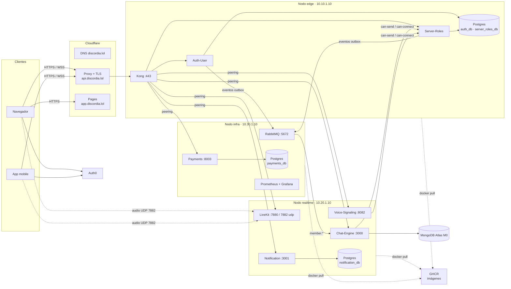
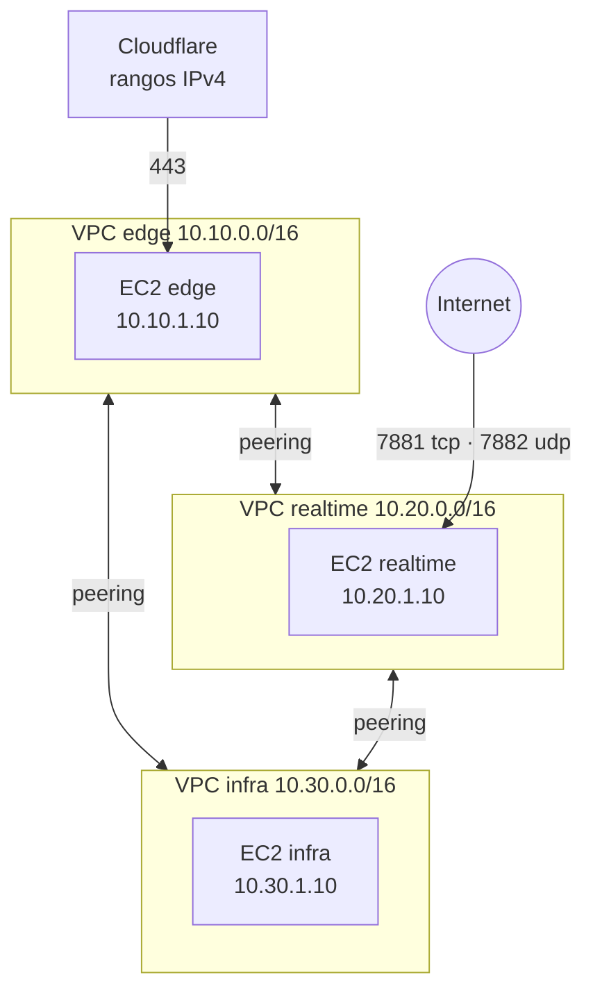
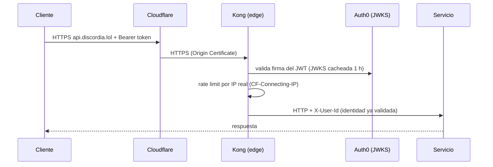
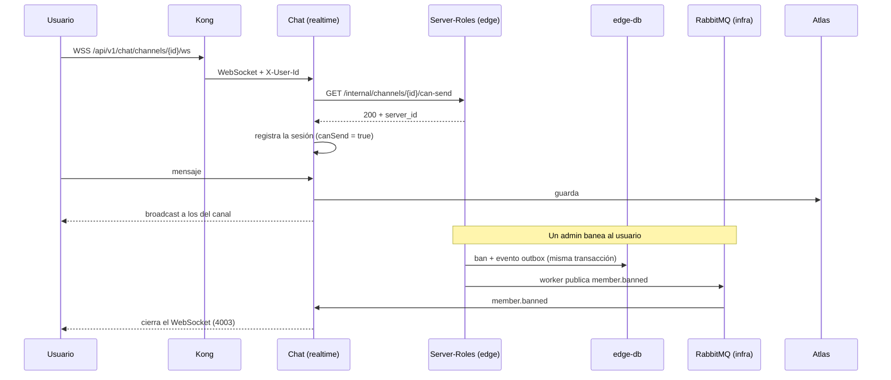
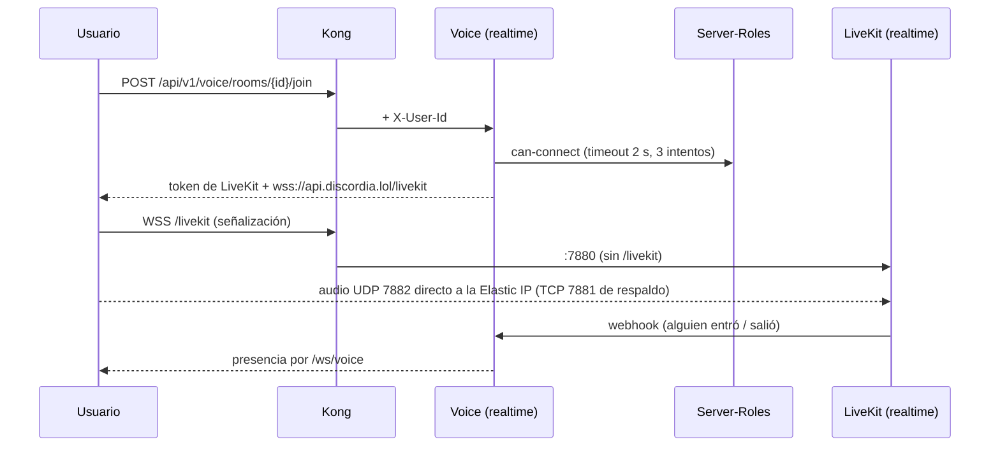
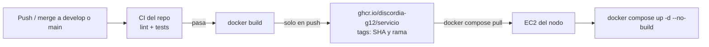

# Arquitectura y despliegue de Discordia

> Estado al 15/10/2026. Describe la arquitectura de tres nodos que reemplaza al monolito (una sola EC2 con
> `docker-compose.yml`), cómo se comunican los servicios, cómo se despliega y qué falta para el corte.

## Índice

1. [Resumen](#1-resumen)
2. [Vista general](#2-vista-general)
3. [Nodos y servicios](#3-nodos-y-servicios)
4. [Red y seguridad](#4-red-y-seguridad)
5. [Cómo se comunican los servicios](#5-cómo-se-comunican-los-servicios)
6. [Datos](#6-datos)
7. [Gateway (Kong)](#7-gateway-kong)
8. [Frontend y mobile](#8-frontend-y-mobile)
9. [Resiliencia: qué pasa si se cae un nodo](#9-resiliencia-qué-pasa-si-se-cae-un-nodo)
10. [Observabilidad](#10-observabilidad)
11. [Despliegue](#11-despliegue)
12. [Costos](#12-costos)
13. [Decisiones y alternativas descartadas](#13-decisiones-y-alternativas-descartadas)
14. [Estado actual y pasos que faltan](#14-estado-actual-y-pasos-que-faltan)
15. [Problemas conocidos y cómo se resolvieron](#15-problemas-conocidos-y-cómo-se-resolvieron)

---

## 1. Resumen

| Tema | Decisión |
|---|---|
| Cómputo | 3 EC2 (`t3.micro`), una por nodo: **edge**, **realtime**, **infra** |
| Red | Una VPC por nodo, unidas por **VPC peering** (malla de 3 conexiones). IPs privadas fijas |
| Entrada de la API | `api.discordia.lol` → **Cloudflare** (proxy, TLS) → **Kong** en edge (443, solo IPs de Cloudflare) |
| Frontend | SPA en **Cloudflare Pages** (`app.discordia.lol`) |
| Bases relacionales | **Postgres en contenedor por nodo** (una base y un usuario por servicio). Sin RDS |
| Historial del chat | **MongoDB Atlas M0** |
| Mensajería | **RabbitMQ** en infra; eventos publicados con el patrón **Outbox** |
| Audio de voz | **LiveKit** en realtime; el audio va directo por UDP 7882 (no pasa por Cloudflare) |
| Imágenes | Cada repo las publica en **GHCR** desde su CI (tag = SHA del commit) |
| Ejecución | **Un solo `deploy/docker-compose.yml`** con un *profile* por nodo; cada EC2 levanta el suyo |
| Infraestructura | **Terraform** (`infra/terraform/`): EC2, VPCs, peering, Security Groups, DNS y Pages |
| Observabilidad | Prometheus + Grafana en infra; Node Exporter + cAdvisor en los tres nodos |
| Costo | $0 de bolsillo: todo con los créditos del plan Free de AWS y planes gratis (Cloudflare, Atlas, GHCR) |

---

## 2. Vista general



---

## 3. Nodos y servicios

Cada nodo es una EC2 en su propia VPC, con IP privada fija. Los límites de memoria son los de
`deploy/docker-compose.yml` (el máximo por contenedor, no el uso real).

### Edge — `10.10.1.10` (Elastic IP, origen de Cloudflare)

| Servicio | Imagen | Puerto publicado | Memoria |
|---|---|---|---|
| `gateway` (Kong 3.4) | `ghcr.io/discordia-g12/gateway` | 443 → 8443 (TLS), 127.0.0.1:8000 | 256 MB |
| `gateway-redis` | `redis:7-alpine` | — | 64 MB |
| `auth-service` | `ghcr.io/discordia-g12/auth-service` | — | 256 MB |
| `auth-outbox-worker` | misma imagen que Auth | — | 128 MB |
| `server-roles-service` | `ghcr.io/discordia-g12/server-roles-service` | 8002 → 8080 (temporal, solo realtime) | 256 MB |
| `server-roles-outbox-worker` | misma imagen que Server-Roles | — | 128 MB |
| `edge-db` | `postgres:16-alpine` | — | 192 MB |

### Realtime — `10.20.1.10` (Elastic IP: `NODE_IP` de LiveKit y allowlist de Atlas)

| Servicio | Imagen | Puerto publicado | Memoria |
|---|---|---|---|
| `chat-engine-service` | `ghcr.io/discordia-g12/chat-engine-service` | 3000 | 256 MB |
| `chat-redis` | `redis:7-alpine` | — | 160 MB |
| `voice-signaling-service` | `ghcr.io/discordia-g12/voice-signaling-service` | 8082 → 8080 | 256 MB |
| `livekit` | `livekit/livekit-server:v1.13.7` | 7880, 7881/tcp, 7882/udp | 384 MB |
| `voice-redis` | `redis:7-alpine` | — | 64 MB |
| `notification-service` | `ghcr.io/discordia-g12/notification-service` | 3001 → 3000 | 128 MB |
| `realtime-db` | `postgres:16-alpine` | — | 128 MB |
| `chat-mongo` | `mongo:7.0` | — | 512 MB — **solo local** (profile `local`) |

### Infra — `10.30.1.10` (IP pública automática, solo para salir a internet)

| Servicio | Imagen | Puerto publicado | Memoria |
|---|---|---|---|
| `rabbitmq` | `rabbitmq:3-management-alpine` | 5672, 127.0.0.1:15672 (panel) | 320 MB |
| `payments-service` | `ghcr.io/discordia-g12/payments-service` | 8003 → 8000 | 192 MB |
| `infra-db` | `postgres:16-alpine` | — | 128 MB |
| `prometheus` | `prom/prometheus:v2.53.0` | 127.0.0.1:9090 | 256 MB |
| `grafana` | `grafana/grafana-oss:11.6.0` | 127.0.0.1:3030 | 128 MB |

### En los tres nodos

| Servicio | Puerto | Memoria |
|---|---|---|
| `node-exporter` (métricas de la máquina) | 9100 (solo infra) | 32 MB |
| `cadvisor` (métricas de cada contenedor) | 9180 (solo infra) | 96 MB |

### Fuera de AWS

| Servicio | Plan | Para qué |
|---|---|---|
| Cloudflare | Free | DNS, proxy y TLS de la API, Pages (SPA) |
| MongoDB Atlas | M0 | Historial del chat |
| Auth0 | (existente) | Identidad: login, tokens |
| GitHub / GHCR | Free | Código, CI, imágenes |

---

## 4. Red y seguridad



- **Una VPC por nodo** con una subnet pública (`x.x.1.0/24`) e Internet Gateway. **Sin NAT Gateway**
  (costaría ~$32/mes): cada EC2 sale a internet con su IP pública y el Security Group bloquea la entrada.
- **VPC peering** entre las tres VPCs (no es transitivo, por eso son tres conexiones). El tráfico entre
  nodos va por la red privada de AWS. Los tres nodos están en la misma zona física (`availability_zone_id
  = use1-az1`), así que no se paga transferencia entre zonas.
- **Sin SSH ni puerto 22**: se entra por **SSM Session Manager**.
- **IMDSv2 obligatorio**, disco cifrado, créditos de CPU en `standard` (si se agotan, la máquina se frena en
  vez de cobrar el excedente).

### Puertos abiertos (Security Groups)

Todo lo que no está en esta tabla está cerrado. El Admin API de Kong (8001), el panel de RabbitMQ,
Prometheus y Grafana **no se publican** (quedan en `127.0.0.1` del host; se accede con port forwarding de SSM).

| Nodo | Puerto | Desde | Para qué |
|---|---|---|---|
| edge | 443/tcp | Rangos de Cloudflare | Kong (API y WebSockets) |
| edge | 8002/tcp | VPC realtime | `can-send` / `can-connect` de Server-Roles (**temporal**) |
| realtime | 3000, 8082, 3001/tcp | VPC edge | Kong → Chat, Voice, Notification |
| realtime | 7880/tcp | VPC edge | Kong → señalización de LiveKit (`/livekit`) |
| realtime | 7881/tcp, 7882/udp | 0.0.0.0/0 | Audio WebRTC (LiveKit valida su propio token) |
| infra | 5672/tcp | VPC edge y realtime | RabbitMQ (workers de outbox y consumidores) |
| infra | 8003/tcp | VPC edge | Kong → Payments |
| edge, realtime | 9100, 9180/tcp | VPC infra | Prometheus → Node Exporter y cAdvisor |

### Cloudflare

| Registro | Tipo | Destino | Proxy |
|---|---|---|---|
| `api` | A | Elastic IP de edge | **Proxied** (nube naranja) |
| `app` | CNAME | `discordia-webapp.pages.dev` | Proxied |

- TLS público lo da Cloudflare; entre Cloudflare y Kong, **Origin Certificate** (modo **Full (strict)**).
- Kong solo acepta a Cloudflare (Security Group) y toma la IP real del usuario del header
  `CF-Connecting-IP` (`KONG_TRUSTED_IPS`), así el rate limiting es por usuario y no por IP de Cloudflare.
- Cloudflare corta los WebSockets inactivos (~100 s): por eso el **heartbeat** (sección 9).

---

## 5. Cómo se comunican los servicios

### Reglas generales

- **Dentro de un nodo**: por nombre de contenedor, en la red de Docker del nodo (`edge`, `realtime`,
  `infra`). Un contenedor **no ve** los de otro nodo.
- **Entre nodos**: a la **IP del host + puerto publicado**, como entre máquinas distintas. Las direcciones
  son variables: `EDGE_HOST`, `REALTIME_HOST`, `INFRA_HOST` (en local `host.docker.internal`; en
  producción las IPs privadas).
- **Desde los clientes**: todo entra por Kong (`api.discordia.lol`), salvo el audio (directo a LiveKit).

### Mapa de llamadas

| Origen | Destino | Tipo | Dirección |
|---|---|---|---|
| Kong | Auth, Server-Roles | HTTP | mismo nodo (`auth-service:8000`, `server-roles-service:8080`) |
| Kong | Chat (REST y WS), Voice (REST y `/ws/voice`), Notification, LiveKit | HTTP / WebSocket | `REALTIME_HOST:3000/8082/3001/7880` |
| Kong | Payments | HTTP | `INFRA_HOST:8003` |
| Chat | Server-Roles `/internal/channels/{id}/can-send` | HTTP síncrono | `EDGE_HOST:8002` — al abrir cada WebSocket |
| Voice | Server-Roles `/internal/channels/{id}/can-connect` | HTTP síncrono (timeout + 3 reintentos) | `EDGE_HOST:8002` — al unirse a voz |
| Auth / Server-Roles (workers) | RabbitMQ | AMQP (publica) | `INFRA_HOST:5672` |
| Chat | RabbitMQ | AMQP (consume `member.*`) | `INFRA_HOST:5672` |
| Voice | LiveKit | API de servidor | mismo nodo (`livekit:7880`) |
| LiveKit | Voice `/webhooks/livekit` | Webhook HTTP | mismo nodo |
| Prometheus | Exportadores de los 3 nodos | HTTP (scrape) | `<NODO>_HOST:9100/9180` |
| Chat | MongoDB Atlas | TLS | internet (allowlist: Elastic IP de realtime) |
| Auth | Auth0 / Cloudinary | HTTPS | internet |

### Pedido a la API



Los servicios confían en el header `X-User-Id` que agrega Kong: **por eso nadie fuera de Kong puede llegar a
sus puertos** (Security Groups).

### Eventos (Outbox + RabbitMQ)

Los servicios que cambian datos guardan el evento en una tabla `outbox_events` **en la misma transacción**
que el cambio. Un worker aparte lo publica en RabbitMQ (al menos una vez; los consumidores deduplican por
`message_id`). Si RabbitMQ está caído, los eventos esperan en la base.

| Productor | Exchange (topic) | Eventos |
|---|---|---|
| Auth-User | `user.events` | `user.registered`, `user.profile.updated` |
| Server-Roles | `server.events` | `channel.created/updated/deleted`, `channels.reordered`, `category.created/updated/deleted`, `categories.reordered`, `role.permissions_updated`, `role.deleted`, `member.role_assigned/removed`, `member.left`, `member.kicked`, `member.banned/unbanned`, `member.muted/unmuted` |

| Consumidor | Cola | Binding | Qué hace |
|---|---|---|---|
| Chat-Engine | `chat_engine_events` (durable) | `member.*` | ban / kick / salida → cierra el WebSocket; mute / unmute → habilita o bloquea el envío |

### Mensaje de chat y ban en vivo



### Voz



---

## 6. Datos

| Dato | Dónde | Detalle |
|---|---|---|
| `auth_db` | `edge-db` (edge) | Usuario `auth_user`. Base y usuario los crea `deploy/postgres-init/edge/01-databases.sh` |
| `server_roles_db` | `edge-db` (edge) | Usuario `server_roles_user` (no puede leer `auth_db` ni al revés) |
| `notification_db` | `realtime-db` (realtime) | Usuario `notification_user` |
| `payments_db` | `infra-db` (infra) | Usuario `payments_user` |
| Historial del chat | MongoDB Atlas M0 | En local, `chat-mongo` (profile `local`) |
| Sesiones de voz, presencia | `voice-redis` (realtime) | Local al nodo |
| Pub/sub del chat | `chat-redis` (realtime) | `noeviction` |
| Rate limiting | `gateway-redis` (edge) | `allkeys-lru` |
| Eventos | RabbitMQ (infra) | Volumen persistente `rabbitmq-data` |

**Cada nodo depende solo de su propia base**: si se cae infra, Auth y Server-Roles siguen funcionando.

**Importante:** Postgres, RabbitMQ y Grafana toman usuario y contraseña **solo la primera vez que arrancan**
(con el volumen vacío). Si después se cambia el valor en `nodes.env`, hay que cambiarlo también adentro
(`ALTER USER`, `rabbitmqctl change_password`, etc.). Ver sección 15.

---

## 7. Gateway (Kong)

- `Gateway/kong.yml` es una **plantilla**: los destinos son variables (`${CHAT_ENGINE_URL}`, ...).
  `Gateway/render-config.sh` las completa al arrancar el contenedor; si queda alguna sin completar, Kong no
  arranca. Sin variables usa los nombres del compose local.
- La configuración (plantilla, `.lua`, `nginx/`) va **dentro de la imagen**.
- Rutas:

| Ruta | Destino | Auth |
|---|---|---|
| `/api/v1/users`, `/api/v1/profile` | Auth-User | JWT |
| `/api/v1/auth/password-reset` | Auth-User | pública + rate limit |
| `/api/v1/servers`, `/channels`, `/roles`, `/moderation`, `/invites` | Server-Roles | JWT |
| `/api/v1/chat` (REST y WebSocket) | Chat-Engine | JWT |
| `/api/v1/voice`, `/ws/voice` | Voice-Signaling | JWT |
| `/livekit` | LiveKit (señalización, sin el prefijo) | token propio de LiveKit |
| `/api/v1/payments`, `/points`, `/boosts` | Payments | JWT + rate limit |
| `/api/v1/notifications`, `/audit`, `/metrics`, `/status` | Notification | JWT (algunas solo staff) |
| `/livez`, `/readyz` | Kong | pública |

- En producción (`deploy/gateway.env`): TLS con el Origin Certificate (`KONG_SSL_CERT`), `KONG_TRUSTED_IPS`
  (rangos de Cloudflare, `terraform output -raw cloudflare_trusted_ips`), `KONG_REAL_IP_HEADER=CF-Connecting-IP`.
  Admin API solo en `127.0.0.1` del contenedor.

---

## 8. Frontend y mobile

- **Web**: Cloudflare Pages compila `Discordia-WebApp` en cada push a `main` (`npm run build`, Node 20) y
  sirve `dist/`. Variables de build: `VITE_API_URL=https://api.discordia.lol` y `VITE_AUTH0_*` (públicas).
  Sin previews por PR (apuntarían a la API de producción). Headers de seguridad y caché en `public/_headers`.
- **Mobile**: `eas.json` fija `EXPO_PUBLIC_API_URL=https://api.discordia.lol` en los perfiles `preview` y
  `production`.
- **Reconexión**: la web (`useChatWebSocket`) y mobile (`useChannelSocket`) se reconectan solas con backoff
  exponencial y recuperan los mensajes perdidos durante el corte.

---

## 9. Resiliencia: qué pasa si se cae un nodo

| Se cae | Sigue funcionando | Deja de funcionar |
|---|---|---|
| **infra** | Login, servidores, canales, chat y voz | Payments; eventos en vivo (bans y mutes se aplican al volver: quedan en la cola o en el outbox); métricas |
| **realtime** | Login, servidores, canales, roles, Payments | Chat, voz, notificaciones |
| **edge** | Nada desde afuera (es la única entrada) | Toda la API. Los WebSockets abiertos se cortan |

Mecanismos:

- **Heartbeat**: Chat (`/channels/:id/ws`) y Voice (`/ws/voice`) mandan un ping de protocolo cada 30 s y
  cierran las conexiones que no responden. Evita el corte de Cloudflare a los ~100 s.
- **Consumidor del chat**: no bloquea el arranque, reintenta para siempre con backoff (1 s → 30 s) y se
  reconecta si RabbitMQ se cae. `/readyz` del chat informa `rabbitmq: ok | disconnected` **sin** marcarse
  no-ready (para no propagar una caída de infra).
- **Outbox**: si RabbitMQ no está, los eventos esperan en la base del productor.
- **Voice → Server-Roles**: timeout de 2 s y 3 intentos; si no responde, el join da 503 (ADR-03 de Voice).
- **`restart: unless-stopped`** y healthchecks en todos los contenedores.

**Dependencia síncrona que queda**: Chat y Voice consultan a Server-Roles (edge) al abrir un WebSocket o
unirse a voz. Si edge cae, ya no importa (tampoco hay API). Se puede eliminar con la "foto de permisos por
eventos" (pendiente, sección 14).

---

## 10. Observabilidad

- **Prometheus** (infra) lee por IP:puerto los **Node Exporter** (9100) y **cAdvisor** (9180) de los tres
  nodos, más el plugin de Prometheus de RabbitMQ. Configuración: `deploy/observability/prometheus.yml.tmpl`
  (las IPs se completan al arrancar). Retención: 7 días.
- **Grafana** (infra) usa el datasource y los dashboards del submódulo `observability` (Pilar), incluido
  *recursos por servicio*.
- Acceso (no están publicados):

```bash
aws ssm start-session --target <id de infra> --document-name AWS-StartPortForwardingSession \
  --parameters portNumber=3030,localPortNumber=3030      # Grafana → http://localhost:3030
```

---

## 11. Despliegue

### Del commit al nodo



- **CI por repo** (`.github/workflows/ci.yml`): en un PR solo construye la imagen; en push a `main` o
  `develop`, además la publica en GHCR. Si los tests fallan, no se publica.
- Etiquetas: **SHA completo del commit** (lo que se despliega, no cambia) y nombre de la rama. Sin `latest`.
- Imágenes: `gateway`, `auth-service`, `server-roles-service`, `chat-engine-service`,
  `voice-signaling-service`, `notification-service`, `payments-service`.
- La SPA no usa imagen: la publica Cloudflare Pages.

### Un compose, tres nodos

`deploy/docker-compose.yml` define los tres nodos. Qué se levanta lo decide `COMPOSE_PROFILES`:

| Dónde | `COMPOSE_PROFILES` |
|---|---|
| Local (los tres juntos) | `edge,realtime,infra,local` |
| EC2 edge / realtime / infra | `edge` / `realtime` / `infra` |

Archivos:

| Archivo | Para qué |
|---|---|
| `deploy/docker-compose.yml` | Servicios, redes por nodo, límites, healthchecks |
| `deploy/.env.example` | Variables: local y la lista completa de producción por nodo |
| `deploy/gateway.env.example` | Solo edge: TLS e IPs de confianza de Cloudflare |
| `deploy/postgres-init/edge/01-databases.sh` | Crea `auth_db` y `server_roles_db` con su usuario |
| `deploy/observability/prometheus.yml.tmpl` | Destinos de Prometheus |
| `infra/terraform/` | Infraestructura (ver abajo) |

### Configuración de cada EC2

- Código: `/opt/discordia` (clon del orquestador + submódulo `observability`).
- Variables y secretos: `/etc/discordia/nodes.env` (permisos 600), con `COMPOSE_PROFILES`, `REGISTRY`, un
  `<SERVICIO>_TAG` por servicio, `EDGE_HOST` / `REALTIME_HOST` / `INFRA_HOST` y los secretos del nodo.
  Generar los secretos con `openssl rand -hex 32` (no `-base64`: sus `/ + =` rompen las URLs).
- Atajo para Compose: `/usr/local/bin/dcn` (no `dc`, que es una calculadora del sistema):

```bash
#!/bin/sh
exec docker compose -f /opt/discordia/deploy/docker-compose.yml --env-file /etc/discordia/nodes.env "$@"
```

- Levantar un nodo: `dcn pull && dcn up -d --no-build && dcn ps`. Orden: **infra → realtime → edge**.
- Desplegar un servicio solo: cambiar su `<SERVICIO>_TAG` en `nodes.env` y
  `dcn pull <servicio> && dcn up -d --no-build --no-deps <servicio>`.
- Si las imágenes son privadas: `docker login ghcr.io` con un token *classic* de solo `read:packages`.

### Terraform

```
infra/terraform/
├── main.tf          3 nodos + 3 peerings + registro DNS api
├── pages.tf         proyecto de Cloudflare Pages + dominio app + CNAME
├── providers.tf     un provider de AWS por nodo (aws.edge / realtime / infra) + Cloudflare
├── variables.tf · locals.tf · outputs.tf · versions.tf
└── modules/
    ├── node/        VPC, subnet, IGW, Security Group, EC2, Elastic IP, rol SSM, budget, cloud-init
    └── peering/     peering entre dos cuentas (o la misma) + rutas
```

- **Estado local** (`terraform.tfstate`, no se commitea): tiene que aplicarlo una sola persona y guardar
  una copia. Alternativa: HCP Terraform (bloque `cloud` comentado en `versions.tf`).
- `manage_dns = false` hasta el corte: recién ahí Terraform administra `api` y `app`.
- Cada cuenta tiene un **budget de $1 sobre el gasto neto** (avisa si algo se cobra fuera de los créditos).
- `terraform output`: IPs de cada nodo, comandos de SSM y `cloudflare_trusted_ips`.

### Local (simular los tres nodos)

```bash
cp deploy/.env.example deploy/.env
docker compose -f deploy/docker-compose.yml up -d --build
curl -i localhost:8000/livez
```

---

## 12. Costos

Todo se paga con los créditos del plan Free de AWS (aprox., us-east-1):

| Recurso | Por mes |
|---|---|
| 3 × EC2 `t3.micro` | ~$23 |
| 3 IPv4 públicas (2 Elastic IP + 1 automática) | ~$11 |
| 3 × 20 GB gp3 | ~$5 |
| Peering, transferencia en la misma zona | $0 |
| Cloudflare (DNS, proxy, Pages), Atlas M0, GHCR, Auth0 | $0 |
| **Total** | **~$39/mes en créditos** |

Al terminarse los créditos o los 6 meses del plan Free, AWS suspende la cuenta: verificar la fecha contra la
entrega. Después del corte hay que **borrar el RDS y la EC2 del monolito** (si no, siguen cobrando).

---

## 13. Decisiones y alternativas descartadas

| Decisión | En lugar de | Por qué |
|---|---|---|
| Postgres en contenedor por nodo | RDS compartido o uno por servicio | $0 extra y cada nodo depende solo de su base. Contra: backups propios |
| VPC por nodo + peering | Una VPC | Permite usar una cuenta de AWS por nodo; el peering es gratis |
| Cloudflare Pages | Vercel | Vercel desaconseja un proxy adelante; Pages convive con la nube naranja |
| Cloudflare proxy en `api` | DNS directo / Vercel rewrites | Oculta la IP, TLS gratis, anti-DDoS. Vercel no soporta WebSockets hacia afuera |
| Compose por nodo + imágenes en GHCR | systemd por contenedor, ECS | Mismo archivo en local y producción; despliegue por servicio con `--no-deps` |
| Redis local en cada nodo | Un Redis compartido en infra | Si cae infra, chat y presencia de voz siguen |
| Sesión + eventos `member.*` (chat) | `can-send` en cada mensaje | Saca la llamada síncrona de cada mensaje |
| Exportadores expuestos solo a infra | Alloy + `remote_write` (ADR-O3) | Más simple para empezar. **Pilar debería actualizar el ADR-O3** |

---

## 14. Estado actual y pasos que faltan

### Estado de los nodos

| Nodo | Estado |
|---|---|
| infra | **Arriba.** RabbitMQ, Prometheus y Grafana OK. Payments: verificar `/readyz` con la imagen nueva (SQLAlchemy fijo) o con la URL `postgresql+psycopg2://` |
| realtime | **Arriba.** Mongo (Atlas) y Redis OK. RabbitMQ: verificar `"rabbitmq":"ok"` después de alinear la contraseña |
| edge | **No levanta todavía.** Auth y Server-Roles fallan porque `edge-db` no creó sus usuarios: el script de inicio no estaba en el repo (lo ocultaba `deploy/.gitignore`). Ya corregido en local, falta commitear y recrear la base (ver abajo) |

### Pasos que faltan

**1. Terminar de levantar los nodos**

- [ ] Commitear y mergear a `develop` (orquestador): `deploy/.gitignore`, `deploy/postgres-init/edge/01-databases.sh`,
      `deploy/.env.example`, URL `postgresql+psycopg2://` de Payments en los dos compose, puntero de Chat-Engine,
      `.gitignore` de la raíz.
- [ ] **Edge**: crear el script a mano en el nodo (o `git pull` después del merge), `dcn down`,
      `docker volume rm discordia-nodes_edge-db-data`, `dcn up -d --no-build`. Verificar que Auth y
      Server-Roles quedan `healthy` y que `curl -sk https://localhost/livez` da 200.
- [ ] Edge: `deploy/gateway.env` (TLS + `KONG_TRUSTED_IPS`) y el Origin Certificate en `deploy/tls/`.
- [ ] Verificar `"rabbitmq":"ok"` en `/readyz` del chat y que los workers de outbox de edge conectan.
- [ ] Verificar en Prometheus (*Status → Targets*) que los tres nodos aparecen *UP*.
- [ ] Payments: `/readyz` en `ready` (imagen nueva con SQLAlchemy 2.0).

**2. Corte (ventana de mantenimiento)**

- [ ] Frenar el monolito.
- [ ] `pg_dump` de `auth_db`, `server_roles_db`, `notification_db` y `payments_db` desde el RDS y restaurar
      cada una en el Postgres de su nodo (`pg_restore --no-owner --role=<usuario>`).
- [ ] `mongodump` del Mongo del monolito y `mongorestore` en Atlas.
- [ ] Cloudflare: borrar los registros viejos `api`, `app` y los de Porkbun (`*`, `www`, raíz).
- [ ] `manage_dns = true` y `terraform apply` (crea `api` → edge y `app` → Pages).
- [ ] Cloudflare: SSL/TLS **Full (strict)** y **Always Use HTTPS**.
- [ ] Auth0: `https://app.discordia.lol` en Callback URLs, Logout URLs y Web Origins.
- [ ] Verificar: `curl -I https://api.discordia.lol/livez` → 200 y la IP de edge directa → timeout.

**3. Validación de punta a punta**

- [ ] Login en `https://app.discordia.lol`.
- [ ] Chat entre web y APK; un canal inactivo más de 5 minutos sigue recibiendo mensajes.
- [ ] Voz entre web y APK con datos móviles (el WebSocket a `/livekit` responde 101; el audio usa la
      Elastic IP de realtime en el puerto 7882).
- [ ] Ban de un usuario conectado: se le cierra el chat.
- [ ] Apagar infra y verificar que chat y voz siguen.

**4. Cierre**

- [ ] Después de unos días estables: snapshot y borrado del **RDS**, `terraform destroy` en `terraform/`
      (EC2 del monolito) y borrar la VPC vieja.
- [ ] Revisar que no queden budgets con alertas.

**5. Pendientes de código y operación**

- [ ] Chat: aplicar en vivo los cambios de rol (`role.*`, `member.role_*`); hoy solo aplica ban, kick,
      salida y mute.
- [ ] Chat: separar permiso de **ver** del de **escribir** (hoy un usuario muteado no puede ni leer el canal).
- [ ] Chat: una cola por instancia si algún día hay más de una (hoy `chat_engine_events` es compartida).
- [ ] Voice: consumir `member.banned` / `member.kicked` para sacar al usuario de la llamada.
- [ ] Foto de permisos por eventos para eliminar `can-send` / `can-connect` y cerrar el puerto 8002.
- [ ] Server-Roles: los íconos de servidor no se guardan (TODO de storage).
- [ ] Backups: `pg_dump` periódico de cada nodo (a S3) y `mongodump` de Atlas (M0 no tiene backups).
- [ ] Compose de la raíz: usar `postgres` por defecto en vez de `RDS_HOST` (hoy el `.env.example` trae el RDS).
- [ ] Fijar versiones de dependencias en todos los repos (un `sqlalchemy` sin fijar rompió Payments).
- [ ] Mobile: sacar `usesCleartextTraffic` cuando todo vaya por HTTPS.
- [ ] Workflow de deploy por SSM (hoy el deploy es manual en cada nodo).
- [ ] Pilar: actualizar el ADR-O3 (exportadores expuestos a infra).
- [ ] Evaluar `t3.small` para realtime si LiveKit se queda sin memoria o CPU en la micro.

---

## 15. Problemas conocidos y cómo se resolvieron

| Síntoma | Causa | Solución |
|---|---|---|
| Kong no arranca: "quedaron variables sin completar" | El chequeo de `render-config.sh` leía el comentario de `kong.yml` | El chequeo ignora líneas de comentario |
| 502 en local con el compose de la raíz | `DATABASE_HOST=${RDS_HOST}` apuntaba al RDS real | `RDS_HOST=postgres` en el `.env` |
| Payments: `No module named 'psycopg'` | `sqlalchemy` sin versión: la 2.1 usa psycopg 3 por defecto | `sqlalchemy>=2.0,<2.1` y URL `postgresql+psycopg2://` |
| Chat: `rabbitmq: disconnected` (`ACCESS_REFUSED`) | RabbitMQ guardó otra contraseña en su primer arranque | `rabbitmqctl change_password` con la de `nodes.env` |
| Edge: `password authentication failed` / `role does not exist` | El script de `edge-db` no estaba en el repo (`.gitignore`) | Patrones anclados (`/edge/`) y recrear el volumen |
| `dc: stack empty` en el nodo | `dc` es una calculadora del sistema | El atajo se llama `dcn` |
| Comandos con `#` fallan en zsh | zsh no acepta comentarios en la terminal | Pegar los comandos sin comentarios o `setopt interactivecomments` |
| CI de Chat sin imagen | Cobertura de ramas 83,9 % < 85 % | Tests del consumidor (defaults, amqplib real, stop) |
| CI de Auth/Server-Roles: bandit B108 | Ruta `/tmp` del heartbeat del worker | `# nosec B108` |
| Gateway mergeado a `main` por error | Base del PR equivocada | Mergear la misma rama a `develop`; default branch = `develop` |
| Imágenes de GHCR `unauthorized` | Paquetes privados | Hacerlos públicos o `docker login ghcr.io` con `read:packages` |
| Secretos con `/ + =` rompen conexiones | Contraseñas base64 dentro de URLs | `openssl rand -hex 32` |
